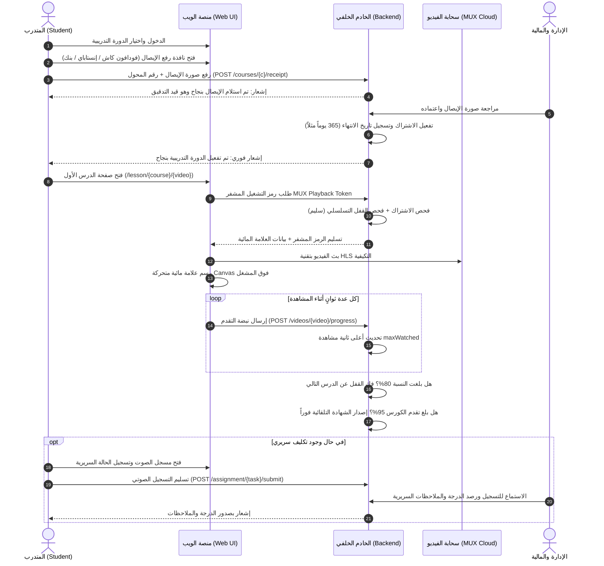
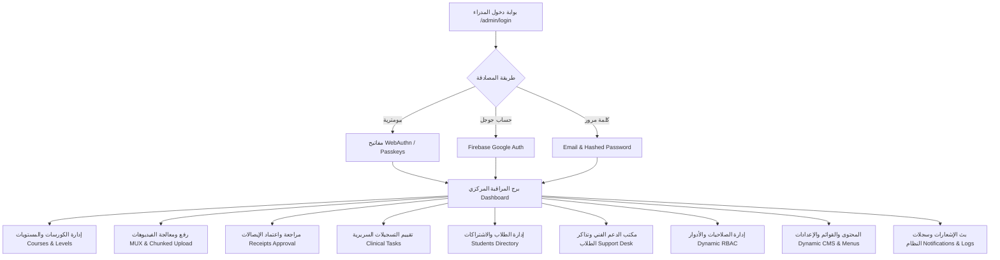
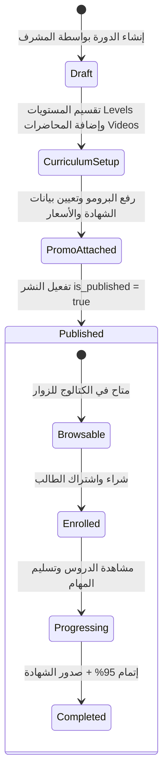

# الدليل الشامل لتدفقات المستخدمين وصلاحيات النظام في منصة الأمين التعليمية
# Comprehensive Al-Ameen Platform User Flows, Capabilities & Architecture Reference

---

## 1. نظرة عامة على المنظومة والهندسة المعمارية (System Architecture Overview)

منصة **الأمين** (Al-Ameen) هي منصة تدريب وتعليم طبي وسريري متطورة مبنية بأحدث معايير **Laravel 11+**، مصممة خصيصاً لتأهيل وتدريب أخصائيي التخاطب وعلاج عيوب النطق والكلام، والأطباء، والمتدربين السريريين.

تعتمد المنصة على بنية حماية وفصل صارمة متعددة البوابات (**Multi-Guard Architecture**):
* **Guard `web` (`App\Models\User`)**: مخصص للطلاب، المتدربين السريريين، والزوار المسجلين.
* **Guard `admin` (`App\Models\Admin`)**: مخصص لطاقم الإدارة، المشرفين السريريين، المحاضرين، ومدققي الحسابات، معزول كلياً عن بوابة الطلاب ومدعوم بنظام صلاحيات ديناميكي (**Dynamic RBAC**) ومصادقة بيومترية (**Passkeys / WebAuthn**).

```
+-----------------------------------------------------------------------------------------------------------------+
|                                           AL-AMEEN MEDICAL PLATFORM                                             |
+-----------------------------------------------------------------------------------------------------------------+
|                                                                                                                 |
|  [ الزوار والضيوف (Guests) ]                                                                                    |
|    ├── تصفح الكتالوج العام والبحث في الكورسات (/courses)                                                         |
|    ├── استعراض تفاصيل الدورة، المستويات، والمحاضرات التجريبية المجانية (/course-details)                          |
|    ├── مشاهدة الفيديو التعريفي والبرومو (MUX HLS / Local Stream)                                                 |
|    └── التحقق الفوري من صحة ومصداقية الشهادات عبر رمز الاستجابة السريع (/verify-certificate/{code})                  |
|                                                                                                                 |
|  [ الطلاب والمتدربون السريريون (Students / Interns - Guard: web) ]                                              |
|    ├── تسجيل الدخول (Email/Password, Google Firebase Auth, 6-Digit OTP Reset, Passkeys)                         |
|    ├── دورة الاشتراك ورفع إيصالات الدفع (فودافون كاش، إنستاباي، تحويل بنكي)                                      |
|    ├── لوحة المتابعة الأكاديمية الذكية (إحصائيات الإنجاز + زر الاستئناف التلقائي لآخر درس تمت مشاهدته)              |
|    ├── بيئة المشاهدة الفائقة المحمية:                                                                           |
|    │     ├── مشغل <mux-player> ببث تكيفي ذكي HLS ورموز تشغيل مشفرة Tokenized MUX Playback                       |
|    │     ├── علامة مائية عائمة متحركة Canvas لمنع تصوير الشاشة (الاسم + الهاتف + المعرف + IP + الوقت)           |
|    │     ├── نظام القفل التسلسلي المزدوج (Sequential Video & Level Locking) حسب نسبة الإنجاز                   |
|    │     └── نبضات حفظ التقدم اللحظية (Progress Heartbeats) لمنع تقديم الفيديو بالتخطي                         |
|    ├── تسليم المهام والتدريبات السريرية الصوتية (تسجيل صوتي مباشر بالمتصفح Web Audio أو رفع ملف)                 |
|    ├── الاستحقاق والإصدار التلقائي للشهادات المعتمدة فور تحقيق نسبة 95% إنجاز                                    |
|    ├── مركز الدعم الفني والمراسلة اللحظية (تذاكر الدعم، الفئات، الأولويات، والمحادثة المباشرة)                     |
|    └── صندوق الإشعارات التفاعلي (Livewire Notifications) وتخصيص الملف الشخصي والأمان                            |
|                                                                                                                 |
|  [ طاقم الإدارة والمدربون (Admin Control Tower - Guard: admin) ]                                                |
|    ├── دخول فائق الأمان (Passkeys بيومترية WebAuthn / بصمة الوجه / Firebase Google / بريد وكلمة مرور)            |
|    ├── إدارة المناهج الهرمية: إنشاء الكورسات، المستويات التدريبية (Levels)، والمحاضرات (Videos)                 |
|    ├── خط رفع الفيديوهات المجزأ المقاوم للانقطاع (Chunked 10MB Uploads) والرفع المباشر لسحابة MUX              |
|    ├── تدقيق واعتماد إيصالات الدفع وتفعيل الاشتراكات وتمديد الصلاحيات التلقائي (Access Expiry Auto-Extension)   |
|    ├── لوحة تقييم التسجيلات السريرية الصوتية ورصد الدرجات وكتابة التغذية الراجعة الأكاديمية                     |
|    ├── برج إدارة الطلاب الشامل: فحص تقدم كل طالب بكل فيديو، تعديل التقدم، منح الشهادات، وتجميد الحسابات        |
|    ├── مكتب إدارة تذاكر الدعم الفني للطلاب، إسناد التذاكر للمشرفين، والملاحظات الداخلية الخاصة                  |
|    ├── نظام الأدوار والصلاحيات الديناميكية (Dynamic RBAC) مع أكثر من 25 صلاحية دقيقة                            |
|    └── إدارة المحتوى والقوائم (Dynamic CMS & Menus) وإعدادات منصة MUX وبوابات الدفع                             |
+-----------------------------------------------------------------------------------------------------------------+
```

---

## 2. مصفوفة الأدوار والمستخدمين (User Roles & Capabilities Matrix)

تتعامل المنصة مع سبع حالات رئيسية للمستخدمين:

| نوع المستخدم / الدور | البوابة (Guard) | نموذج البيانات (Model) | آلية المصادقة المعتمدة | نطاق الصلاحيات والإمكانيات |
| :--- | :--- | :--- | :--- | :--- |
| **1. الزائر العام (Guest)** | لا يوجد (Public) | غير مسجل | تصفح حر بدون تسجيل | تصفح الواجهة الرئيسية، كتالوج الكورسات، تفاصيل الدورات، مشاهدة البرومو، معاينة الدروس المجانية، التحقق من الشهادات برمز QR، قراءة التقييمات، وصفحة الاتصال. |
| **2. الطالب / المتدرب (Student)** | `web` | `App\Models\User` | بريد وكلمة مرور مشفرة + تفعيل البريد، Firebase Google Auth، رمز OTP السريع، وPasskeys. | شراء الكورسات عبر رفع الإيصالات، مشاهدة الدروس المقفلة تسلسلياً مع العلامة المائية، تسجيل المهام السريرية بالصوت، فتح تذاكر دعم فني، استلام الشهادات التلقائية، وإدارة الأمان. |
| **3. الطالب الموقوف (Suspended Student)** | `web` | `App\Models\User` (`status = suspended`) | مسجل لكن حسابه مجمد من الإدارة | يُحجب فوراً برمجياً من مشاهدة أي محاضرة غير مجانية، ويُمنع من رفع الإيصالات أو التكليفات السريرية وتظهر له رسالة مراجعة الإدارة (403 Forbidden). |
| **4. مدرب / محاضر سريري (Instructor)** | `admin` | `App\Models\Admin` | بريد وكلمة مرور، Firebase Google، أو مفاتيح WebAuthn Passkeys | استعراض الدورات والمناهج الأكاديمية، الاستماع إلى تسجيلات الطلاب الصوتية، رصد الدرجات (من 0 إلى 100)، كتابة التغذية الراجعة الإكلينيكية، ومتابعة قائمة الطلاب. |
| **5. المشرف السريري والأكاديمي (Clinical Supervisor)** | `admin` | `App\Models\Admin` | بريد وكلمة مرور، Firebase Google، أو مفاتيح WebAuthn Passkeys | كافة صلاحيات المحاضر + إنشاء وتعديل الكورسات والمستويات، رفع الفيديوهات والمحاضرات، اعتماد الشهادات يدوياً للطلاب، وبث إشعارات للمتدربين. |
| **6. المسؤول المالي ومدقق الإيصالات (Finance Admin)** | `admin` | `App\Models\Admin` | بريد وكلمة مرور، Firebase Google، أو مفاتيح WebAuthn Passkeys | فحص وتدقيق إيصالات فودافون كاش، إنستاباي، والتحويلات البنكية، قبول الإيصال وتفعيل اشتراك الطالب فوراً، أو رفض الإيصال مع كتابة سبب الرفض الإلزامي، وتصدير التقارير. |
| **7. مسؤول الدعم الفني والإشعارات (Support Admin)** | `admin` | `App\Models\Admin` | بريد وكلمة مرور، Firebase Google، أو مفاتيح WebAuthn Passkeys | استلام تذاكر الدعم والرد عليها، تغيير حالات وأولويات التذاكر، إسناد التذاكر للمشرفين، إضافة ملاحظات داخلية سرية، وبث الإشعارات والتعاميم الجماعية للمتدربين. |
| **8. المالك / مدير النظام العام (Super Admin / Owner)** | `admin` | `App\Models\Admin` (`slug: super_admin` أو الصلاحية `*`) | بريد وكلمة مرور، Firebase Google، ومفاتيح Passkeys | تحكم مطلق في المنصة: إدارة المدراء والأدوار، ضبط محتوى الـ CMS والقوائم، تعديل إعدادات الفيديو وMUX، تفعيل/تعطيل القفل والعلامة المائية، والاطلاع على سجلات النظام (Log Viewer). |

---

## 3. تدفق الزوار وغير المسجلين (Guest / Public Flow)

```mermaid
flowchart TD
    Start[زيارة المنصة /] --> Catalog[تصفح الكورسات /courses]
    Start --> VerifyCert[فحص شهادة /verify-certificate/{code}]
    Start --> PublicPages[صفحات: تواصل معنا / تقرير التدقيق / آراء العملاء]
    
    Catalog --> CourseDetails[صفحة تفاصيل الكورس /course-details?course=slug]
    CourseDetails --> PromoVideo[مشاهدة البرومو التعريفي]
    CourseDetails --> CurriculumPreview[استعراض فهرس المستويات والدروس]
    CourseDetails --> FreeLesson{هل يوجد درس مجاني؟}
    FreeLesson -->|نعم| PlayFree[مشاهدة المعاينة المجانية Free Preview]
    FreeLesson -->|لا| RequireEnroll[الطلب يتطلب اشتراكاً]
    
    RequireEnroll --> AuthCheck{هل يملك حساباً؟}
    AuthCheck -->|لا| Register[إنشاء حساب جديد مع تفعيل البريد]
    AuthCheck -->|نعم| Login[تسجيل الدخول Email / Google Firebase]
    Register --> StudentDashboard[الدخول كطالب وبدء إجراءات الاشتراك]
    Login --> StudentDashboard
```

### الإمكانيات والخيارات المتاحة للزائر:
1. **استكشاف الكتالوج العام (`/courses`)**:
   - البحث بالاسم والمجال السريري.
   - استعراض الكروت التعريفية للكورسات: صورة الغلاف (Thumbnail)، السعر الحالي، السعر الأصلي قبل الخصم، عدد المستويات، عدد المحاضرات، ومدة صلاحية الوصول بالأيام (`access_duration_days`).
2. **استعراض صفحة تفاصيل الدورة (`/course-details`)**:
   - قراءة التوصيف الكامل للدورة التدريبية باللغتين العربية والإنجليزية.
   - تشغيل **الفيديو التعريفي (Promo Video)** عبر المشغل الآمن سواء كان مستضافاً على MUX أو السيرفر المحلي.
   - استعراض الهيكل المنهجي للدورة (المستويات والدروس)، مع تمييز الدروس المجانية بوضوح.
   - في حال كان الدرس موسوماً كـ **معاينة مجانية (`is_free_preview = true`)**، يستطيع الزائر مشاهدته مباشرة دون دفع.
3. **التحقق العام من صحة الشهادات (`/verify-certificate/{code}`)**:
   - إمكانية التحقق الفوري من أي شهادة صادرة من المنصة للمستشفيات أو جهات التوظيف بإدخال الكود المرجعي (مثل `ALM-2026-X8B9K2L1`) أو مسح رمز **QR** المطبوع على الشهادة.
   - يعرض النظام: اسم المتدرب، اسم الدورة، تاريخ التخرج، نسبة الإنجاز المحققة، وخاتم الاعتماد الرقمي.
4. **التسجيل والمصادقة المرنة**:
   - التسجيل التقليدي: الاسم، البريد، الهاتف، كلمة المرور، المدينة، والبلد مع تأكيد البريد الإلكتروني.
   - التسجيل الفوري بحساب Google عبر **Firebase Authentication** بنقرة واحدة.
   - استعادة الحساب السريعة عبر رمز تحقق **OTP** مكون من 6 أرقام يصل لبريد المتدرب صالح لمدة 10 دقائق.

---

## 4. تدفق الطالب والمتدرب السريري (Student / Trainee Flow)



### تفاصيل رحلة الطالب وإمكانياته الكاملة:

### أ. دورة الاشتراك والدفع اليدوي المحكم (Payment & Manual Receipt Cycle):
1. عند اختيار الدورة غير المشترك بها، تعرض المنصة وسائل الدفع المعتمدة مع التعليمات المنسقة:
   - **فودافون كاش (Vodafone Cash)**: رقم المحفظة والتعليمات.
   - **إنستاباي (InstaPay)**: المعرف السريع والتعليمات.
   - **تحويل بنكي (Bank Wire)**: اسم البنك، اسم صاحب الحساب، ورقم الآيبان (IBAN).
2. يرفع الطالب صورة التحويل مع كتابة المبلغ ورقم الحساب/المحفظة المحول منها واسم المودع.
3. يُسجل الإيصال في قاعدة البيانات بحالة `pending`.
4. بمجرد اعتماد الإيصال من الإدارة، يتم إنشاء سجل اشتراك نشط في جدول `course_user` وتحديد تاريخ الانتهاء `access_expires_at` تلقائياً.
5. في حال كان الاشتراك سارياً وقام المتدرب بالتجديد، يقوم النظام بمد الصلاحية من تاريخ الانتهاء المستقبلي وليس من اليوم الحالي.

---

### ب. لوحة التحكم الأكاديمية الذكية (`/dashboard` & `/courses`):
1. **شريط استئناف التعلم (Resume Learning Hero)**:
   - يتعرف النظام تلقائياً على آخر محاضرة كان يشاهدها الطالب في أي دورة عبر `last_watched_at`.
   - يظهر زر كبير ينقل الطالب بضغطة واحدة إلى الثانية التي توقف عندها لاستكمال الدراسة فوراً.
2. **عدادات الإنجاز الحية**:
   - إجمالي الكورسات المشترك بها.
   - عدد المحاضرات المكتملة وإجمالي الدروس.
   - متوسط نسبة الإنجاز العام.
   - عدد الشهادات المكتسبة والمهام السريرية المسلمة.
3. **فلترة ومتابعة المقررات (`/courses` للطلاب)**:
   - تقسيم الكورسات إلى: مكتملة (100%)، قيد التقدم (1-99%)، ولم تبدأ بعد (0%).

---

### ج. بيئة تشغيل المحاضرات الفائقة الأمان (`/lesson/{course}/{video}`):
تعد شاشة الدرس في المنصة تجربة هندسية متكاملة تضمن التعليم الفعال وتمنع السرقة العلمية:

1. **نظام القفل التسلسلي المزدوج (Sequential Video & Level Lock)**:
   - **قفل المستويات (Level Lock)**: لا يمكن للمتدرب فتح أي مستوى تعليمي متقدم حتى يكمل كافة فيديوهات المستوى السابق.
   - **قفل الدروس (Lesson Lock)**: داخل المستوى، لا يفتح الدرس رقم 2 إلا بعد أن يكمل الطالب نسبة المشاهدة المطلوبة للدرس رقم 1 (محددة افتراضياً بـ 80% وتُعدل لكل درس).
   - **حرية المراجعة للدروس المنجزة**: بمجرد أن يستوفي الطالب نسبة المشاهدة للدرس أو المستوى، يصبح مفتوحاً بشكل دائم للمراجعة وإعادة المشاهدة في أي وقت دون أي قيود.
2. **العلامة المائية المتحركة المضادة لتصوير الشاشة (Dynamic Anti-Piracy Watermark)**:
   - يتم تشغيل طبقة رسم فيزيائية متحركة بتقنية HTML5 Canvas تطفو فوق مشغل الفيديو.
   - ترتطم العلامة بحواف المشغل بمسارات وزوايا متغيرة باستمرار، مما يجعل إخفاءها ببرامج المونتاج مستحيلاً.
   - تحتوي العلامة المائية على بيانات الطالب الحساسة:
     - **الاسم الكامل للمتدرب**
     - **رقم الهاتف المسجل**
     - **المعرف الرقمي للطالب (Student ID)**
     - **عنوان الـ IP الحالي**
     - **التاريخ والوقت اللحظي**
3. **نبضات التقدم الذكية (Real-Time Progress Heartbeats)**:
   - يُرسل المشغل نبضات منتظمة عبر AJAX للمسار `POST /videos/{video}/progress`.
   - يسجل السيرفر أعلى ثانية وصل إليها الطالب فعلياً (`maxWatchedSeconds`)؛ فلا يمكن للطالب خداع النظام بتقديم شريط الفيديو للنهاية، بل يجب حضور وقت الدرس الحقيقي.
4. **مشغل MUX السحابي الموثق (Tokenized `<mux-player>`)**:
   - يتم طلب توقيع رقمي مشفر (RS256 JWT Token) عبر `GET /videos/{video}/playback-token`.
   - لا يتم كشف روابط الفيديو الحقيقية؛ فالتوكن صالح لفترة زمنية محددة ومرتبط برقم المعرف وجلسة المتدرب.
5. **المحرك المحلي البديل (Resilient Local Streaming)**:
   - إذا كان الفيديو مستضافاً محلياً، يمر طلب الملف عبر مسار محمي يفحص صلاحية الاشتراك والقفل التسلسلي قبل بث البيانات المشفرة مع ترويسات أمنية تمنع التحميل والتخزين المؤقت غير المصرح به (`nosniff`, `no-store`).

---

### د. التدريب والتقييم السريري الصوتي (`/assignment/{task}`):
ميزة فريدة لمنصة الأمين مصممة خصيصاً لمجال التخاطب وعلاج عيوب النطق:
1. **مسجل الصوت المباشر بالمتصفح (Browser Voice Recorder)**:
   - يستخدم واجهات برمجة الصوت `MediaRecorder` و `Web Audio API`.
   - يسجل الطالب بصوته نطق الحروف أو تشخيص الحالة الطبية مباشرة دون الحاجة لأي برامج خارجية.
   - يتم معاينة التسجيل الصوتي وإعادة تشغيله قبل الإرسال.
2. **رفع الملفات البديلة**:
   - إمكانية رفع تسجيل صوتي مسجل مسبقاً بصيغ (`mp3`, `wav`, `m4a`, `ogg`, `webm`).
3. **كتابة الملاحظات الإكلينيكية**:
   - حقل مخصص لتدوين الملاحظات والتشخيص المصاحب للتسجيل الصوتي.
4. **متابعة التقييم والدرجات**:
   - متابعة حالة المهمة: معلقة (`pending`) أو تم التقييم (`graded`).
   - استعراض درجة المحاضر (من 100) مع التغذية الراجعة الطبية المكتوبة.

---

### هـ. الشهادات المعتمدة والاستحقاق الذكي (`/certificates` & `/settings/certificates`):
1. **الاستحقاق التلقائي الكامل (Zero-Touch Auto-Issuance)**:
   - مع كل نبضة تقدم يسجلها الطالب في أي محاضرة، يقوم `CertificateService` بحساب متوسط تقدم المتدرب في مجمل الدورة.
   - فور وصول النسبة إلى **95%** (أو النسبة المحددة في النظام)، يُصدر النظام الشهادة المعتمدة فوراً دون الحاجة لطلبها أو انتظار موافقة يدوية.
2. **الشهادة الرقمية الموثقة**:
   - كود اعتماد رسمي فريد غير قابل للتكرار: `ALM-YYYY-XXXXXXXX`.
   - رمز استجابة سريعة متجهي أصيل (**Vector SVG QR Code**) يُنشأ لحظياً على السيرفر بدون مكتبات خارجية ثقيلة، يقود مباشرة إلى صفحة الفحص الرسمية.
   - عرض الشهادة وتحميلها وطباعتها أو استعراض نسختها المخصصة المعتمدة.

---

### و. مركز الدعم الفني والتذاكر التفاعلية (`/support`):
1. **إنشاء التذاكر المتخصصة**:
   - إمكانية فتح تذكرة دعم واختيار التصنيف بدقة:
     - **دعم فني وتقني** (مشاكل المشغل، التسجيل، التحميل).
     - **استفسار سريري وأكاديمي** (أسئلة طبية موجهة للمحاضرين).
     - **فواتير ومدفوعات** (استفسارات الإيصالات والاشتراكات).
     - **محتوى الدورات والدروس**.
     - **الشهادات والاعتمادات**.
     - **استفسار عام**.
   - تحديد درجة الأولوية: منخفضة، متوسطة، مرتفعة، عاجلة جداً.
   - ربط التذكرة بكورس محدد من الكورسات المسجل بها الطالب.
2. **غرفة المحادثة اللحظية (Support Chat Thread)**:
   - واجهة محادثة تفاعلية مع المشرفين.
   - دعم التحديث التلقائي للرسائل الجديدة عبر تقنية الاستطلاع السريع (`/support/{ticket}/poll`).
   - إمكانية إغلاق التذكرة بعد حل المشكلة أو إعادة فتحها عند الحاجة.

---

### ز. إعدادات الحساب والأمان البيومتري (`/settings/*`):
1. **الملف الشخصي (`settings/profile`)**:
   - تحديث الاسم، رقم الهاتف، الدولة، المدينة، العنوان، ورفع الصورة الشخصية (Avatar).
   - تغيير اللغة المفضلة للمنصة (العربية / الإنجليزية).
2. **الأمان المتقدم (`settings/security`)**:
   - تغيير كلمة المرور الحالية.
   - تفعيل التحقق بخطوتين (Two-Factor Authentication).
   - تسجيل وإدارة مفاتيح المرور البيومترية (**Passkeys / WebAuthn**) لتسجيل الدخول السريع ببصمة الإصبع أو الوجه.

---

## 5. تدفق برج المراقبة والإدارة وطاقم العمل (Admin Control Tower Flow)



### صلاحيات وإمكانيات الإدارة بالتفصيل:

### 1. إدارة المناهج والمستويات التدريبية (`/admin/courses`):
- **إنشاء وتعديل الكورسات**:
  - الاسم بالعربية والإنجليزية، الرابط المخصص (Slug).
  - الوصف التفصيلي للمقرر بالعربية والإنجليزية.
  - السعر وسعر الخصم، وتحديد أيام الصلاحية (`access_duration_days` مثل 365 يوماً).
  - تخصيص قالب وبيانات الشهادة الخاصة بالكورس: اسم المسؤول الموقع، المسمى الوظيفي، واختيار خلفية مخصصة للشهادة.
  - ترتيب ظهور الدورة في الصفحة الرئيسية، وتفعيل/تعطيل النشر (`is_published`).
- **إدارة الفيديو التعريفي (Course Promo Video)**:
  - رفع برومو الدورة بالتجزئة (Chunked Upload).
  - الرفع المباشر لسحابة MUX من المتصفح مع شريط تقدم مباشر.
  - ربط كود MUX Playback ID يدوياً أو استخدام روابط محلية.
- **إدارة المستويات التدريبية الديناميكية (Dynamic Levels Hierarchy)**:
  - تقسيم الدورة إلى مستويات متدرجة (مثل: المستوى التمهيدي، المستوى المتوسط، التطبيق السريري المتقدم).
  - تحديد ترتيب المستوى وتفعيل/تعطيل نشره.
  - قفل وفتح المستويات برمجياً للطلاب وفق الترتيب العلمي.

---

### 2. إدارة المحاضرات ورفع الفيديوهات المتقدم (`/admin/courses/{c}/lessons/*`):
توفر المنصة بنية معالجة فيديو تعتبر من الأكثر تطوراً واستقراراً:
- **نظام الرفع المجزأ المقاوم للأعطال (Chunked Resilient Upload)**:
  - تقطيع ملفات الفيديو الضخمة (1GB إلى 4GB+) في المتصفح إلى أجزاء بحجم 10 ميجابايت.
  - إرسال الشرائح بالتتابع مع إمكانية استئناف الرفع في حال تذبذب اتصال الإنترنت.
  - يقوم السيرفر بقطع اتصال قاعدة البيانات مؤقتاً أثناء رفع الشرائح لمنع استنزاف قنوات الاتصال (`DB::disconnect()`).
  - عند اكتمال الشرائح، يجمع السيرفر الملف عبر دفقات تدفق مباشر عالية الكفاءة (`stream_copy_to_stream`)، ثم يرسله تلقائياً إلى سحابة **MUX**، أو يخزنه محلياً إذا لم تكن السحابة مهيأة.
- **الرفع السحابي المباشر إلى MUX (Direct Browser-to-MUX Upload)**:
  - طلب رابط رفع موثق مؤقت من سحابة MUX مباشرة.
  - يتم الرفع من متصفح المشرف إلى سحابة MUX بدون استهلاك موارد أو معالج سيرفر المنصة.
  - تستقبل المنصة إشعارات **MUX Webhooks** الموقعة بـ HMAC-SHA256 وتقوم بتحديث المحاضرة بالـ `playback_id` والمدة الزمنية فور انتهاء المعالجة السحابية.
- **تخصيص سياسات كل محاضرة**:
  - تحديد نسبة المشاهدة المطلوبة لاجتياز الدرس وفك قفل الدرس التالي (`min_completion_percentage`).
  - تحديد ما إذا كان الدرس **معاينة مجانية (Free Preview)** متاحاً لجميع الزوار.
  - تفعيل أو تعطيل نشر الدرس بشكل مستقل.
  - **ميزة التحديث الجماعي لإعدادات الفيديو (Bulk Video Settings)**: إمكانية تطبيق نسبة إنجاز أو حالة نشر على جميع دروس المستوى أو الدورة دفعة واحدة.
- **ربط التكليف السريري الصوتي فورياً**:
  - إمكانية إنشاء مهمة سريرية صوتية وربطها بالمحاضرة مباشرة من داخل شاشة إضافة/تعديل الدرس.

---

### 3. تدقيق واعتماد إيصالات الدفع (`/admin/receipts`):
- استعراض قائمة الإيصالات مع فلاتر الحالة: معلقة (`pending`)، معتمدة (`approved`)، مرفوضة (`rejected`).
- فحص صورة الإيصال بدقة عالية، اسم المحول، رقم الحساب أو المحفظة، المبلغ المحول، وتاريخ العملية.
- **الاعتماد الآلي بنقرة واحدة (`Approve`)**:
  - يقوم النظام تلقائياً بتفعيل اشتراك الطالب في الكورس المعني.
  - حساب تاريخ انتهاء الاشتراك بدقة وتوثيق هوية المشرف الذي اعتمد العملية.
  - إرسال إشعار فوري في حساب الطالب يعلمه بفتح الدورة.
- **رفض الإيصال مع التوثيق (`Reject`)**:
  - اشتراط كتابة سبب الرفض (مثل: صورة التحويل غير واضحة، المبلغ غير مطابق، العملية مكررة).
  - إرسال سبب الرفض للطالب مع تمكينه من إعادة رفع إيصال صحيح.

---

### 4. تقييم المهام والتسجيلات السريرية (`/admin/tasks`):
- استعراض جميع التسجيلات الصوتية المسلمة من المتدربين السريريين.
- الاستماع المباشر للتسجيل الصوتي من خلال مشغل صوتي مدمج في لوحة التحكم.
- مراجعة ملاحظات الطالب السريرية وتشخيصه للحالة.
- رصد الدرجة من 100 وتدوين الملاحظات التوجيهية وتصحيح مخارج الألفاظ.
- إرسال التقييم للطالب لحظياً وظهوره في سجله الأكاديمي.

---

### 5. برج إدارة الطلاب والمتدربين (`/admin/students`):
يوفر للمشرفين رؤية شاملة بزاوية 360 درجة لكل متدرب:
- **الملف الأكاديمي للطالب**:
  - استعراض الكورسات المسجل بها ونسبة إنجازه في كل كورس.
  - **جدول التقدم الدقيق**: استعراض سجل مشاهدة الطالب لكل محاضرة على حدة، عدد الثواني المشاهدة، وتاريخ آخر مشاهدة.
  - استعراض المهام السريرية المسلمة ودرجاتها.
  - سجل الإيصالات والمدفوعات السابقة.
  - الشهادات المكتسبة مع إمكانية استعراضها وطباعتها.
- **الإجراءات الإدارية المباشرة**:
  - **تعديل نسبة التقدم يدوياً**: إمكانية تعديل نسبة مشاهدة الطالب لأي محاضرة عند الضرورة الأكاديمية.
  - **إصدار شهادة يدوية استثنائية**: منح الطالب شهادة الدورة يدوياً مع تحديد نسبة الإنجاز المعتمدة أو رفع ملف شهادة مصمم خارجياً (PDF أو صورة).
  - **حذف أو إلغاء شهادة صادرة**.
  - **منح اشتراك في كورس يدوياً**: تسجيل الطالب في أي دورة مع تحديد تاريخ بدء وانتهاء الوصول دون الحاجة لإيصال دفع.
  - **تعديل أو إلغاء الاشتراك**: تمديد فترة الوصول أو إنهاؤها.
  - **إيقاف / تنشيط الحساب (`Toggle Status`)**: تجميد حساب الطالب المشاغب أو المخالف لمنعه من الدخول ومشاهدة أي محتوى فوراً.
  - **إعادة تعيين كلمة مرور الطالب**، أو تعديل بياناته الأساسية.
  - **حذف حساب الطالب** نهائياً من النظام.

---

### 6. مكتب الدعم الفني وتذاكر الطلاب (`/admin/support`):
- استعراض التذاكر المفتوحة ومصنفة حسب الأولوية والتصنيف وحالة المعالجة.
- إسناد التذكرة لمشرف محدد أو استلامها ذاتياً (`Assign to me`).
- تغيير حالة التذكرة: مفتوحة، قيد المعالجة، بانتظار رد الطالب، بانتظار رد المشرف، تم الحل، مغلقة.
- تغيير الأولوية: منخفضة، متوسطة، مرتفعة، عاجلة جداً.
- **الملاحظات الداخلية الخاصة (Internal Notes)**: إمكانية كتابة ملاحظات بين المشرفين داخل التذكرة لا يراها الطالب نهائياً.
- التحديث اللحظي للمحادثة عبر تقنية الاستطلاع التلقائي.

---

### 7. نظام الصلاحيات والأدوار الديناميكية (Dynamic RBAC Tower):
- لا تقتصر المنصة على أدوار ثابتة، بل تتيح إنشاء وتعديل أدوار غير محدودة من خلال واجهة الرقابة:
  - **صلاحيات الكورسات**: `courses.view`, `courses.manage`, `courses.publish`.
  - **صلاحيات المهام والتقييم**: `tasks.view`, `tasks.grade`.
  - **صلاحيات الشهادات**: `certificates.view`, `certificates.approve`.
  - **صلاحيات الإيصالات والمالية**: `receipts.view`, `receipts.verify`, `receipts.approve`, `receipts.reject`.
  - **صلاحيات الطلاب**: `students.view`, `students.manage`.
  - **صلاحيات الإشعارات**: `notifications.view`, `notifications.send`, `notifications.manage`.
  - **صلاحيات الإدارة والمدراء**: `admins.view`, `admins.manage`, `roles.manage`.
  - **صلاحيات المحتوى والإعدادات**: `cms.manage`, `menus.manage`, `settings.manage`.
  - **صلاحيات التقارير**: `reports.view`, `reports.export`.
- إمكانية تعيين دور أساسي لكل مشرف مع إمكانية إضافة استثناءات صلاحيات فردية (Custom Permission Overrides).

---

### 8. إدارة المحتوى والقوائم وإعدادات النظام (`/admin/settings`):
- **الهوية البصرية والبيانات العامة**:
  - اسم الموقع بالعربية والإنجليزية، الشعار النصي، ورفع لوجو المنصة الرسمي.
- **إعدادات الدفع المالي المباشر**:
  - تعديل رقم فودافون كاش وتعليمات التحويل.
  - تعديل معرف تطبيق إنستاباي.
  - تعديل بيانات الحساب البنكي، اسم البنك، واسم صاحب الحساب ورقم الآيبان (IBAN).
- **السياسات الأكاديمية والأمنية العامة**:
  - تفعيل أو تعطيل **القفل التسلسلي للفيديوهات** على مستوى المنصة ككل.
  - تفعيل أو تعطيل **العلامة المائية المتحركة** فوق مشغل الفيديو.
  - نسبة النجاح الافتراضية لمنح الشهادات (95%).
- **إعدادات واختبار سحابة MUX**:
  - إدخال مفاتيح MUX API: `token_id` و `token_secret` و `webhook_secret`.
  - زر فحص واختبار الاتصال اللحظي بالسحابة (**Test Mux Connection**) للتأكد من جاهزية البث والرفع المباشر.
- **إدارة المحتوى الديناميكي (Dynamic CMS Blocks)**:
  - **قسم الواجهة الرئيسي (Hero Section)**: العناوين بالعربية والإنجليزية، أزرار الدعوة للإجراء (CTA)، وإحصائيات المنصة (عدد الطلاب، عدد الكورسات، ونسب النجاح).
  - **قسم عن المنصة (About Section)**: نبذة عن المركز، وركائز التدريب السريري الأربع مع الأيقونات والشروحات.
  - **قسم الأسئلة الشائعة (FAQ Section)**: إضافة وتعديل وحذف الأسئلة والإجابات الشائعة وتفعيلها أو إخفاؤها.
- **إدارة القوائم الديناميكية (Dynamic Menu Manager)**:
  - التحكم الكامل في القائمة العلوية (Header Menu) والقائمة السفلية (Footer Menu).
  - إضافة روابط جديدة، ربطها بمسارات المنصة الداخلية أو روابط خارجية.
  - ترتيب العناصر وإظهارها أو إخفاؤها فورياً.

---

### 9. مركز بث الإشعارات وسجلات النظام (`/admin/notifications` & `/admin/logs`):
- مركز متقدم بنظام Livewire لبث التعاميم والتنبيهات الموجهة:
  - إرسال إشعار لجميع طلاب المنصة دفعة واحدة.
  - إرسال إشعار لطلاب دورة تدريبية محددة.
  - إرسال إشعار فردي لطالب معين.
- مستعرض سجلات الخادم المباشر (**Log Viewer**) لمراقبة أداء السيرفر واستكشاف أي أخطاء في تكامل MUX أو الدفع أو رفع الملفات.

---

## 6. هندسة الفيديوهات والكورسات التفصيلية (Courses & Video Engineering)

### دورة حياة الكورس (Course Lifecycle):


### البنية التحتية لمعالجة الفيديوهات (Multi-Driver Pipeline):
| الميزة التقنية | كيفية عملها في المنصة | الفائدة السريرية والأكاديمية |
| :--- | :--- | :--- |
| **محرك MUX السحابي** | بث بتقنية HLS Adaptive Bitrate وتشفير JWT Tokens | تشغيل فوري بدون تقطيع وبأعلى جودة حتى على شبكات الهاتف الضعيفة وتأمين كامل للمحتوى. |
| **الرفع المجزأ (Chunked Upload)** | تقطيع الملف لشرائح 10MB ورفعها بالتتابع مع فصل الـ DB مؤقتاً | رفع محاضرات 1GB إلى 4GB بأمان تام دون تجاوز حدود الاستضافات أو انقطاع الاتصال. |
| **الرفع المباشر (Direct Upload)** | رفع الفيديو من متصفح المشرف إلى MUX مباشرة | توفير كامل لموارد ومعالج السيرفر وسرعة فائقة في معالجة الملفات الضخمة. |
| **المحرك المحلي البديل (Local Driver)** | حفظ الفيديو داخل مجلد محمي مع فحص الاشتراك والقفل | شبكة أمان دائمة في حال عدم توفر أو توقف الاتصال السحابي. |
| **العلامة المائية الفيزيائية (Canvas Overlay)** | رسم متحرك يتنقل بزوايا حرة ويعرض الاسم والهاتف والـ IP | منع تصوير الشاشة وتثبيط أي محاولة لقرصنة ونشر المادة العلمية. |
| **القفل التسلسلي الذكي (Sequential Lock)** | اشتراط نسبة إنجاز (افتراضياً 80%) لفتح الدرس التالي | ضمان التدرج العلمي للدارس ومنع القفز على مراحل التشخيص والعلاج. |
| **تتبع التقدم الحقيقي (Heartbeat Monitoring)** | رصد أعلى ثانية مشاهدة وتجاهل القفز السريع | التأكد من أن الطالب حضر واستوعب المحاضرة فعلياً قبل منحه الشهادة. |

---

## 7. مقارنة شاملة لإمكانيات المستخدمين (User Capabilities Comparison)

| الإمكانية / الخاصية | زائر عام (Guest) | طالب مفعّل (Student) | طالب موقوف (Suspended) | مدرب سريري (Instructor) | مشرف أكاديمي (Supervisor) | مسؤول مالي (Finance) | مدير النظام (Super Admin) |
| :--- | :---: | :---: | :---: | :---: | :---: | :---: | :---: |
| تصفح الكورسات والمستويات | ✅ | ✅ | ✅ | ✅ | ✅ | ✅ | ✅ |
| مشاهدة الفيديو التعريفي (البرومو) | ✅ | ✅ | ✅ | ✅ | ✅ | ✅ | ✅ |
| مشاهدة المحاضرات المجانية (Free Preview) | ✅ | ✅ | ❌ | ✅ | ✅ | ✅ | ✅ |
| فحص الشهادات بالـ QR والكود | ✅ | ✅ | ✅ | ✅ | ✅ | ✅ | ✅ |
| رفع إيصالات سداد الاشتراكات | ❌ | ✅ | ❌ | ❌ | ❌ | ❌ | ❌ |
| مشاهدة محاضرات الكورس المشترك به | ❌ | ✅ | ❌ | ✅ | ✅ | ❌ | ✅ |
| تخطي القفل التسلسلي للمحاضرات | ❌ | ❌ | ❌ | ✅ | ✅ | ❌ | ✅ |
| تسليم المهام السريرية الصوتية | ❌ | ❌ | ❌ | ❌ | ❌ | ❌ |
| فتح تذاكر الدعم الفني والاستفسارات | ❌ | ✅ | ❌ | ❌ | ❌ | ❌ | ❌ |
| الحصول على شهادة إتمام معتمدة | ❌ | ✅ (تلقائي عند 95%) | ❌ | ❌ | ❌ | ❌ | ❌ |
| اعتماد وتدقيق إيصالات الدفع | ❌ | ❌ | ❌ | ❌ | ❌ | ✅ | ✅ |
| تقييم المهام الصوتية ورصد الدرجات | ❌ | ❌ | ❌ | ✅ | ✅ | ❌ | ✅ |
| إنشاء وتعديل الكورسات والمستويات | ❌ | ❌ | ❌ | ❌ | ✅ | ❌ | ✅ |
| رفع الفيديوهات المجزأة وسحابة MUX | ❌ | ❌ | ❌ | ❌ | ✅ | ❌ | ✅ |
| تعديل بيانات ونسب تقدم الطلاب | ❌ | ❌ | ❌ | ❌ | ✅ | ❌ | ✅ |
| تجميد / تنشيط حسابات الطلاب | ❌ | ❌ | ❌ | ❌ | ✅ | ❌ | ✅ |
| منح الشهادات الاستثنائية يدوياً | ❌ | ❌ | ❌ | ❌ | ✅ | ❌ | ✅ |
| إدارة تذاكر الدعم والرد على الطلاب | ❌ | ❌ | ❌ | ❌ | ✅ | ❌ | ✅ |
| بث الإشعارات للطلاب | ❌ | ❌ | ❌ | ❌ | ✅ | ❌ | ✅ |
| تعديل المحتوى (CMS) والقوائم والإعدادات | ❌ | ❌ | ❌ | ❌ | ❌ | ❌ | ✅ |
| إدارة المشرفين والأدوار والصلاحيات (RBAC) | ❌ | ❌ | ❌ | ❌ | ❌ | ❌ | ✅ |
| استعراض سجلات النظام (Log Viewer) | ❌ | ❌ | ❌ | ❌ | ❌ | ❌ | ✅ |

---

## 8. الخلاصة التنفيذية (Executive Summary)

تمثل منصة **الأمين التعليمية** نموذجاً معمارياً متكاملاً يوازن بين:
1. **سهولة وسلاسة تجربة المتدرب**: عبر مسارات دفع مرنة، تسجيل سريع بحسابات جوجل، مسجل صوتي مباشر للمهام السريرية، واستحقاق تلقائي للشهادات بمجرد إتمام الدورة.
2. **الحماية الفائقة للمحتوى الرقمي**: من خلال البث السحابي المشفر بروابط MUX المؤقتة، والعلامة المائية الفيزيائية العائمة المضادة للتصوير، ونظام القفل التسلسلي المقاوم للتخطي.
3. **التحكم والرقابة الشاملة للإدارة**: من خلال برج مراقبة مركزي يعزل مهام الإشراف الأكاديمي، التدقيق المالي، الدعم الفني، وإدارة المناهج والطلاب بنظام صلاحيات ديناميكي متقدم.

