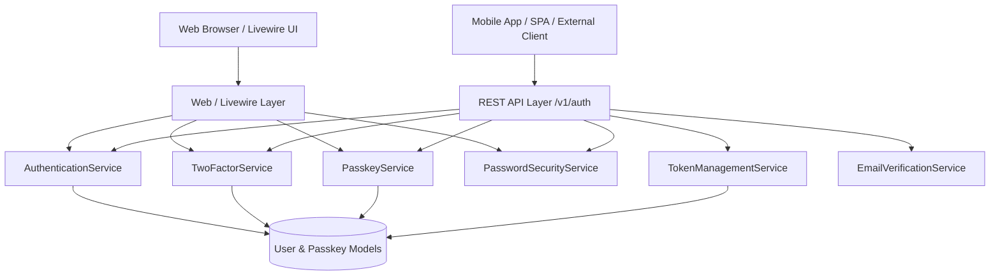

# Unified Authentication & Security Architecture (Web & API)

This document describes the unified authentication, security, Two-Factor Authentication (2FA), Passkeys (WebAuthn), and API Token architecture implemented in Alameen.

---

## 1. Architectural Philosophy: Write Once, Use Everywhere

All business logic, security constraints, cryptographic operations, and rate limiting reside in dedicated **Services** (`app/Services/Auth/`). Both the **Web Layer** (Livewire, Fortify, Session controllers) and the **API Layer** (Sanctum REST API controllers) consume these exact same services.



---

## 2. Service Layer Reference

All services are injectable via Laravel's service container (`app(...)` or constructor/method injection).

### `App\Services\Auth\AuthenticationService`
* Handles credential login with automated rate limiting and throttling.
* Dynamically detects whether a user has 2FA enabled:
  * For API: Generates a short-lived `challenge_token` stored in Cache and returns `LoginResult::requiresTwoFactor()`.
  * For Web: Stores challenged user state in the HTTP session and returns `LoginResult::requiresTwoFactor()`.
* Creates Sanctum Personal Access Tokens for API clients or starts a session for Web clients.
* Registration via `CreateNewUser` and event dispatching.
* Logout and device revocation.
* `getSecurityProfile(User $user)`: Overview of user verification, 2FA status, passkey count, and active API tokens.

### `App\Services\Auth\TwoFactorService`
* `enable(User $user)`: Generates TOTP secret, returns QR code SVG, setup URL, and manual secret key.
* `confirm(User $user, string $code)`: Verifies 6-digit TOTP code, stamps `two_factor_confirmed_at`, and returns recovery codes.
* `disable(User $user)`: Wipes 2FA secret, confirmed timestamp, and recovery codes.
* `verifyCode(User $user, string $code)`: Validates 6-digit TOTP against user secret.
* `verifyRecoveryCode(User $user, string $recoveryCode)`: Validates and rotates used recovery code.
* `createTwoFactorChallenge(User $user, int $ttlSeconds = 300)`: Issues a stateless temporary token for API 2FA challenge flows.
* `verifyTwoFactorChallenge(string $challengeToken, ?string $code, ?string $recoveryCode)`: Validates challenge token and code, returns authenticated user.

### `App\Services\Auth\PasskeyService`
* `generateLoginOptions(?User $user)`: Generates WebAuthn assertion challenge, caches serialized options under a UUID `challenge_id`.
* `verifyLogin(array $credential, string $challengeId)`: Validates client's WebAuthn assertion, validates counter to prevent clone attacks, and updates `last_used_at`.
* `generateRegistrationOptions(User $user)`: Generates WebAuthn creation challenge for the authenticated user.
* `registerPasskey(User $user, string $name, array $credential, string $challengeId)`: Validates WebAuthn attestation, ensures credential uniqueness, and stores passkey.
* `listPasskeys(User $user)`: Formatted collection of passkeys.
* `deletePasskey(User $user, int $passkeyId)`: Securely deletes user passkey.

### `App\Services\Auth\TokenManagementService`
* `createToken(User $user, string $name, array $abilities = ['*'], ?DateTimeInterface $expiresAt = null)`: Issues new Sanctum token.
* `listTokens(User $user)`: Lists active personal access tokens.
* `revokeToken(User $user, int $tokenId)`: Revokes specific token.
* `revokeCurrentToken(User $user)`: Revokes active Bearer token.
* `revokeOtherTokens(User $user)`: Revokes all tokens except current.
* `revokeAllTokens(User $user)`: Revokes all tokens.

### `App\Services\Auth\PasswordSecurityService`
* `updatePassword(User $user, string $currentPassword, string $newPassword)`: Validates current password and securely updates to new hash.
* `sendResetLink(string $email)`: Sends password reset email.
* `resetPassword(array $credentials)`: Validates token and resets password.

### `App\Services\Auth\EmailVerificationService`
* `sendVerificationNotification(User $user)`: Sends verification email.
* `verify(User $user, string $hash)`: Validates signature and marks email verified.

---

## 3. API Endpoints Reference (`/api/v1/auth`)

All responses adhere to the standard JSON format:
```json
{
  "success": true,
  "message": "Human readable message",
  "data": { ... }
}
```

### Public Authentication

#### 1. Register
* **Route:** `POST /api/v1/auth/register`
* **Body:**
  ```json
  {
    "name": "Jane Doe",
    "email": "jane@example.com",
    "password": "Password123!",
    "password_confirmation": "Password123!",
    "device_name": "iPhone 15"
  }
  ```
* **Response (201):**
  ```json
  {
    "success": true,
    "message": "Registration successful.",
    "data": {
      "user": { "id": 1, "name": "Jane Doe", "email": "jane@example.com", "email_verified_at": null },
      "token": "1|qXy...plainTextToken",
      "token_type": "Bearer"
    }
  }
  ```

#### 2. Login (Password)
* **Route:** `POST /api/v1/auth/login`
* **Body:**
  ```json
  {
    "email": "jane@example.com",
    "password": "Password123!",
    "device_name": "Mobile Client"
  }
  ```
* **Success Response (when 2FA is disabled):**
  ```json
  {
    "success": true,
    "message": "Authenticated successfully.",
    "data": {
      "status": "success",
      "user": { "id": 1, "name": "Jane Doe", "email": "jane@example.com" },
      "token": "2|...",
      "token_type": "Bearer"
    }
  }
  ```
* **2FA Challenge Response (when 2FA is enabled):**
  ```json
  {
    "success": true,
    "message": "Two-factor authentication code required.",
    "data": {
      "status": "requires_two_factor",
      "two_factor_challenge_token": "a1b2c3d4e5f6..."
    }
  }
  ```

#### 3. Complete 2FA Challenge
* **Route:** `POST /api/v1/auth/2fa/challenge`
* **Body (with TOTP code):**
  ```json
  {
    "challenge_token": "a1b2c3d4e5f6...",
    "code": "123456",
    "device_name": "Mobile Client"
  }
  ```
* **Body (with Recovery code):**
  ```json
  {
    "challenge_token": "a1b2c3d4e5f6...",
    "recovery_code": "abcd-efgh-ijkl",
    "device_name": "Mobile Client"
  }
  ```
* **Response (200):** Returns user and Bearer token.

---

### Passkey Authentication (Passwordless WebAuthn)

#### 1. Passkey Login Options
* **Route:** `GET /api/v1/auth/passkeys/login/options`
* **Response (200):**
  ```json
  {
    "success": true,
    "data": {
      "challenge_id": "9b1deb4d-3b7d-4bad-9bdd-2b0d7b3dcb6d",
      "options": {
        "challenge": "...",
        "rpId": "example.com",
        "userVerification": "required"
      }
    }
  }
  ```

#### 2. Passkey Login Verify
* **Route:** `POST /api/v1/auth/passkeys/login`
* **Body:**
  ```json
  {
    "challenge_id": "9b1deb4d-3b7d-4bad-9bdd-2b0d7b3dcb6d",
    "credential": {
      "id": "...",
      "rawId": "...",
      "type": "public-key",
      "response": { "authenticatorData": "...", "clientDataJSON": "...", "signature": "...", "userHandle": "..." }
    },
    "device_name": "MacBook Chrome"
  }
  ```
* **Response (200):** Returns user, passkey metadata, and Bearer token.

---

### Authenticated Endpoints (`Authorization: Bearer <token>`)

#### User & Security Profile
* `GET /api/v1/auth/me`: Returns profile, 2FA enabled status, passkeys count, and API tokens count.
* `POST /api/v1/auth/logout`: Revokes the current token (`all_devices: true` revokes all).
* `POST /api/v1/auth/password/update`: Updates password with `current_password`, `password`, and `password_confirmation`.

#### Two-Factor Authentication Management
* `POST /api/v1/auth/2fa/enable`: Initiates setup; returns QR Code SVG, URL, and manual secret key.
* `POST /api/v1/auth/2fa/confirm`: Confirms with 6-digit `code`; returns recovery codes.
* `DELETE /api/v1/auth/2fa/disable`: Disables 2FA.
* `GET /api/v1/auth/2fa/recovery-codes`: Lists recovery codes.
* `POST /api/v1/auth/2fa/recovery-codes`: Regenerates new recovery codes.

#### Passkeys Management
* `GET /api/v1/auth/passkeys`: Lists user's passkeys.
* `GET /api/v1/auth/passkeys/register/options`: Returns creation challenge options.
* `POST /api/v1/auth/passkeys/register`: Registers a new passkey with `name`, `challenge_id`, and `credential`.
* `DELETE /api/v1/auth/passkeys/{id}`: Deletes a passkey.

#### Personal Access Tokens Management
* `GET /api/v1/auth/tokens`: Lists active API tokens.
* `POST /api/v1/auth/tokens`: Creates a new token with optional `abilities` and `expires_at`.
* `DELETE /api/v1/auth/tokens/{id}`: Revokes specific token.
* `DELETE /api/v1/auth/tokens`: Revokes all other tokens.

---

## 4. Console Commands & Auditing

* Audit security health across all accounts:
  ```bash
  php artisan security:audit
  ```
* Audit a specific account:
  ```bash
  php artisan security:audit --user=user@example.com
  ```
