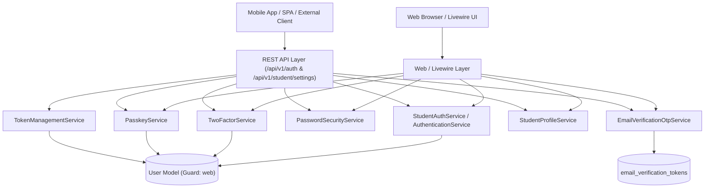

# Unified Authentication & Security Architecture (Web & API)

This document describes the unified authentication, security, Two-Factor Authentication (2FA), Passkeys (WebAuthn), Email Verification OTP, and API Token architecture implemented in Alameen.

---

## 1. Architectural Philosophy: Write Once, Use Everywhere

All business logic, security constraints, cryptographic operations, and rate limiting reside in dedicated **Services** (`app/Services/Auth/`). Both the **Web Layer** (Livewire, Fortify, Session controllers) and the **API Layer** (Sanctum REST API controllers `/api/v1/*`) consume these exact same services.



---

## 2. Service Layer Reference

All services are injectable via Laravel's service container (`app(...)` or constructor/method injection).

### `App\Services\Auth\EmailVerificationOtpService`
* **Purpose**: Manages 6-digit numeric OTP generation, throttling, email dispatch, and verification.
* `sendOtp(User $user)`: Generates a cryptographically random 6-digit numeric OTP, stores the hash and expiration in `email_verification_tokens`, and dispatches `App\Notifications\EmailVerificationOtpNotification`.
* `verifyOtp(User $user, string $otp)`: Validates the submitted OTP against the stored token, verifies expiration (default 15 minutes TTL), marks `$user->email_verified_at = now()`, and purges used tokens.
* `resend(User $user)`: Helper method wrapping cooldown verification and OTP redispatch.

### `App\Services\Auth\StudentAuthService` / `AuthenticationService`
* Handles credential login with automated rate limiting and throttling.
* Dynamically detects whether a user has 2FA enabled:
  * For API: Generates a short-lived `challenge_token` stored in Cache and returns `LoginResult::requiresTwoFactor()`.
  * For Web: Stores challenged user state in the HTTP session and returns `LoginResult::requiresTwoFactor()`.
* Creates Sanctum Personal Access Tokens for API clients or starts a session for Web clients.
* Registration via `CreateNewUser` and event dispatching.
* Logout and device token revocation.
* `getSecurityProfile(User $user)`: Overview of user verification, 2FA status, passkey count, and active API tokens.

### `App\Services\Auth\TwoFactorService`
* `enable(User $user)`: Generates TOTP secret, returns QR code SVG, setup URL, and manual secret key.
* `confirm(User $user, string $code)`: Verifies 6-digit TOTP code, stamps `two_factor_confirmed_at`, and returns recovery codes.
* `disable(User $user)`: Wipes 2FA secret, confirmed timestamp, and recovery codes.
* `verifyCode(User $user, string $code)`: Validates 6-digit TOTP against user secret.
* `verifyRecoveryCode(User $user, string $recoveryCode)`: Validates and rotates used recovery code.
* `createTwoFactorChallenge(User $user, int $ttlSeconds = 300)`: Issues a stateless temporary token for API 2FA challenge flows.
* `verifyTwoFactorChallenge(string $challengeToken, ?string $code, ?string $recoveryCode)`: Validates challenge token and code, returns authenticated user.

### `App\Services\Auth\PasskeyService`
* `generateLoginOptions(?User $user)`: Generates WebAuthn assertion challenge, caches serialized options under a UUID `challenge_id`.
* `verifyLogin(array $credential, string $challengeId)`: Validates client's WebAuthn assertion, validates counter to prevent clone attacks, and updates `last_used_at`.
* `generateRegistrationOptions(User $user)`: Generates WebAuthn creation challenge for the authenticated user.
* `registerPasskey(User $user, string $name, array $credential, string $challengeId)`: Validates WebAuthn attestation, ensures credential uniqueness, and stores passkey.
* `listPasskeys(User $user)`: Formatted collection of passkeys.
* `deletePasskey(User $user, int $passkeyId)`: Securely deletes user passkey.

### `App\Services\Auth\PasswordSecurityService`
* `updatePassword(User $user, string $currentPassword, string $newPassword)`: Validates current password and securely updates to new hash.
* `sendResetOtp(string $email)`: Generates 6-digit OTP and emails it for password reset.
* `verifyResetOtp(string $email, string $otp)`: Validates 6-digit reset OTP and issues a reset signature.
* `resetPasswordWithOtp(string $email, string $otp, string $password)`: Resets password securely with the verified OTP.

### `App\Services\Auth\StudentProfileService`
* `updateProfile(User $user, array $data)`: Updates personal details, phone, country, city, address, locale, and optional avatar image.
* `deleteAccount(User $user, string $password)`: Verifies current student password and permanently purges user profile, enrollments, and tokens.

---

## 3. RESTful API Endpoints Reference (`/api/v1/*`)

All responses adhere to the standard JSON envelope:
```json
{
  "success": true,
  "message": "Human readable message",
  "data": { ... }
}
```

---

### A. Public & Guest Authentication (`/api/v1/auth/*`)

#### 1. Register Student Account
* **Route:** `POST /api/v1/auth/register`
* **Body:**
  ```json
  {
    "name": "أحمد محمد",
    "email": "ahmed@example.com",
    "password": "Password123!",
    "password_confirmation": "Password123!",
    "phone": "+201012345678",
    "country": "Egypt",
    "city": "Cairo",
    "device_name": "iPhone 15"
  }
  ```
* **Response (201):**
  ```json
  {
    "success": true,
    "message": "تم إنشاء الحساب بنجاح.",
    "data": {
      "user": {
        "id": 15,
        "name": "أحمد محمد",
        "email": "ahmed@example.com",
        "status": "active",
        "email_verified": false
      },
      "token": "1|qXy...plainTextToken",
      "token_type": "Bearer"
    }
  }
  ```

#### 2. Login (Email & Password)
* **Route:** `POST /api/v1/auth/login`
* **Body:**
  ```json
  {
    "email": "ahmed@example.com",
    "password": "Password123!",
    "device_name": "Mobile Client"
  }
  ```
* **Standard Success (2FA Disabled):**
  ```json
  {
    "success": true,
    "message": "تم تسجيل الدخول بنجاح.",
    "data": {
      "status": "success",
      "user": { "id": 15, "name": "أحمد محمد", "email": "ahmed@example.com" },
      "token": "2|...",
      "token_type": "Bearer"
    }
  }
  ```
* **2FA Challenge Required (2FA Enabled):**
  ```json
  {
    "success": true,
    "message": "رمز التحقق الثنائي مطلوب.",
    "data": {
      "status": "requires_two_factor",
      "two_factor_challenge_token": "a1b2c3d4e5f6..."
    }
  }
  ```

#### 3. Complete Two-Factor Challenge
* **Route:** `POST /api/v1/auth/two-factor-challenge`
* **Body (TOTP Code):**
  ```json
  {
    "challenge_token": "a1b2c3d4e5f6...",
    "code": "123456",
    "device_name": "Mobile Client"
  }
  ```
* **Body (Recovery Code):**
  ```json
  {
    "challenge_token": "a1b2c3d4e5f6...",
    "recovery_code": "abcd-efgh-ijkl",
    "device_name": "Mobile Client"
  }
  ```
* **Response (200):** Returns authenticated user profile and Bearer token.

#### 4. Social & Firebase Authentication
* **POST `/api/v1/auth/firebase`**: Authenticate using Firebase ID Token (`id_token`).
* **GET `/api/v1/auth/google/redirect`**: Obtain Google OAuth authorization redirect URL.
* **POST `/api/v1/auth/google/token`**: Authenticate using Google OAuth Access Token (`access_token`).

#### 5. WebAuthn Passkey Login (Passwordless)
* **POST `/api/v1/auth/passkeys/login-options`**: Issue WebAuthn challenge.
* **POST `/api/v1/auth/passkeys/login`**: Verify client assertion credentials and authenticate.

#### 6. Password Reset via 6-Digit Email OTP
* **POST `/api/v1/auth/forgot-password`**: Request 6-digit password reset OTP to email (`throttle:otp`).
* **POST `/api/v1/auth/verify-otp`**: Validate 6-digit OTP code (`email`, `otp`).
* **POST `/api/v1/auth/reset-password`**: Submit new password with the verified OTP.

---

### B. Authenticated Student Account & Email Verification (`/api/v1/auth/*`)
*Requires `Authorization: Bearer <token>` and `student.approved` middleware.*

#### 1. Current Student Profile
* **Route:** `GET /api/v1/auth/me`
* **Response (200):**
  ```json
  {
    "success": true,
    "data": {
      "user": {
        "id": 15,
        "name": "أحمد محمد",
        "email": "ahmed@example.com",
        "phone": "+201012345678",
        "country": "Egypt",
        "city": "Cairo",
        "locale": "ar",
        "status": "active",
        "avatar_url": "https://alameen.com/avatars/user.jpg",
        "initials": "أ م",
        "email_verified": true,
        "email_verified_at": "2026-11-07T12:00:00Z",
        "two_factor_enabled": false
      }
    }
  }
  ```

#### 2. Resend 6-Digit Email Verification OTP
* **Route:** `POST /api/v1/auth/email/verification-notification`
* **Middleware:** `auth:sanctum`, `student.approved`, `throttle:otp` (5 attempts per minute)
* **Response (200 - Fresh OTP Sent):**
  ```json
  {
    "success": true,
    "already_verified": false,
    "message": "تم إرسال رمز تأكيد البريد الإلكتروني (OTP) بنجاح."
  }
  ```
* **Response (200 - Already Verified):**
  ```json
  {
    "success": true,
    "already_verified": true,
    "message": "البريد الإلكتروني مؤكد بالفعل."
  }
  ```

#### 3. Verify Email with 6-Digit OTP
* **Route:** `POST /api/v1/auth/email/verify-otp`
* **Middleware:** `auth:sanctum`, `student.approved`, `throttle:otp`
* **Body:**
  ```json
  {
    "otp": "482910"
  }
  ```
* **Response (200):**
  ```json
  {
    "success": true,
    "already_verified": false,
    "message": "تم تأكيد البريد الإلكتروني بنجاح.",
    "data": {
      "user": {
        "id": 15,
        "name": "أحمد محمد",
        "email": "ahmed@example.com",
        "email_verified": true,
        "email_verified_at": "2026-11-07T14:30:00Z"
      }
    }
  }
  ```
* **Response (422 - Invalid OTP):**
  ```json
  {
    "message": "رمز التأكيد غير صالح أو منتهي الصلاحية.",
    "errors": {
      "otp": ["رمز التأكيد غير صالح أو منتهي الصلاحية."]
    }
  }
  ```

#### 4. Logout
* **Route:** `POST /api/v1/auth/logout`
* **Body (optional):**
  ```json
  {
    "all_devices": false
  }
  ```
* **Response (200):** Revokes active Sanctum token (or all tokens when `all_devices: true`).

---

### C. Student Settings & Security Management (`/api/v1/student/settings/*`)
*Requires `Authorization: Bearer <token>` and `student.approved` middleware.*

#### 1. Profile Management
* **`GET /api/v1/student/settings/profile`**: Get current profile settings.
* **`POST /api/v1/student/settings/profile`** (or **`PUT`**): Update profile fields (`name`, `phone`, `country`, `city`, `address`, `locale`, optional `avatar` file).
* **`DELETE /api/v1/student/settings/profile`** (or **`POST /api/v1/student/settings/profile/delete`**): Delete account (`password` required for confirmation).

#### 2. Password Update
* **`PUT /api/v1/student/settings/password`** (or **`POST`**): Update password (`current_password`, `password`, `password_confirmation`).

#### 3. Security Overview
* **`GET /api/v1/student/settings/security`**: Returns comprehensive security posture (2FA status, passkeys count, verification date, recent login methods).

#### 4. Two-Factor Authentication (TOTP)
* **`POST /api/v1/student/settings/two-factor/enable`**: Initiate setup; returns QR Code SVG, setup key, and manual URL.
* **`POST /api/v1/student/settings/two-factor/confirm`**: Confirm with 6-digit TOTP `code`; activates 2FA and returns recovery codes.
* **`DELETE /api/v1/student/settings/two-factor`**: Disable 2FA.
* **`GET /api/v1/student/settings/two-factor/recovery-codes`**: Retrieve recovery codes.
* **`POST /api/v1/student/settings/two-factor/recovery-codes`**: Regenerate recovery codes.

#### 5. WebAuthn Passkeys
* **`GET /api/v1/student/settings/passkeys`**: List student's registered passkeys.
* **`POST /api/v1/student/settings/passkeys/options`**: Generate creation options challenge.
* **`POST /api/v1/student/settings/passkeys`**: Register new passkey (`name`, `challenge_id`, `credential`).
* **`DELETE /api/v1/student/settings/passkeys/{passkeyId}`**: Remove registered passkey.

---

## 4. Console Commands & Auditing

* **Security Audit**:
  ```bash
  php artisan security:audit
  php artisan security:audit --user=student@example.com
  ```
* **Apidog & OpenAPI Spec Synchronization**:
  ```bash
  php artisan apidog:sync
  ```
  Synchronizes `swagger.json` with `public/swagger.json` and pushes updates to the cloud Apidog workspace.
