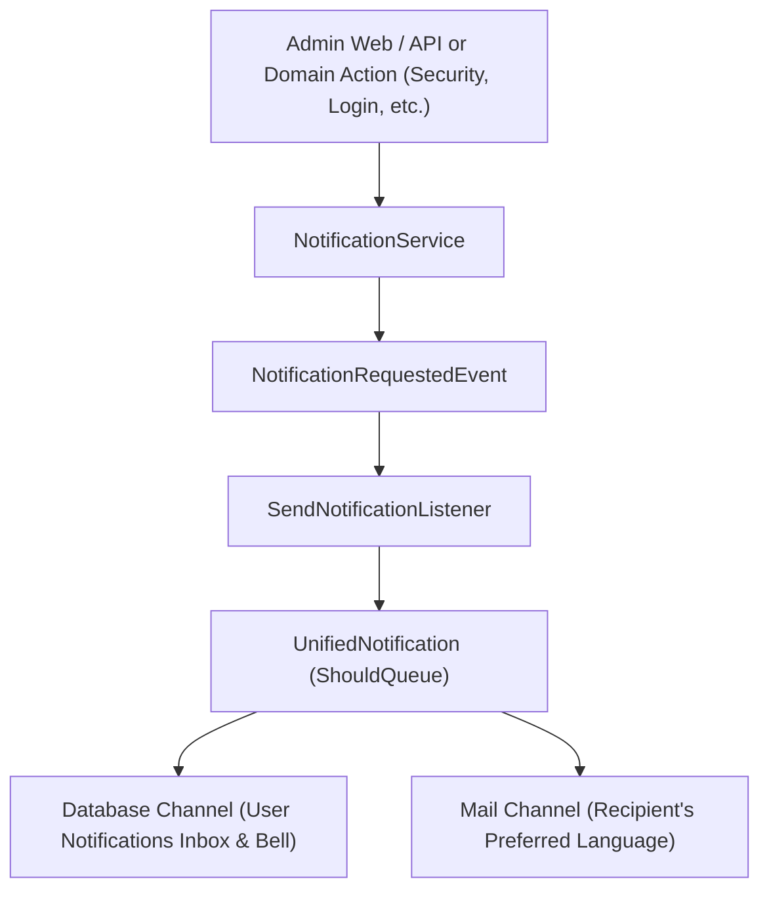

# Notification System Architecture

This project features a centralized, event-driven notification system spanning both **Web** and **API**, with full **multilingual** support (Arabic/English), delivery across multiple channels (**Database/In-App** and **Email/Mail**), and complete management for administrators and regular users.

---

## 1. Core Principles & Design Requirements

1. **Service-Driven**: Code is written once in [`App\Services\Notification\NotificationService`](file:///d:/WORK/LARAVEL/Alameen/app/Services/Notification/NotificationService.php). Web controllers, Livewire components, and API controllers all consume this service.
2. **Unified Notification Class**: Instead of creating a separate notification class for each event, the entire system utilizes a single class: [`App\Notifications\UnifiedNotification`](file:///d:/WORK/LARAVEL/Alameen/app/Notifications/UnifiedNotification.php).
3. **Event-Driven Architecture**: All notifications are triggered by dispatching [`App\Events\NotificationRequestedEvent`](file:///d:/WORK/LARAVEL/Alameen/app/Events/NotificationRequestedEvent.php), which is captured by [`App\Listeners\SendNotificationListener`](file:///d:/WORK/LARAVEL/Alameen/app/Listeners/SendNotificationListener.php) to instantiate and deliver the unified notification.
4. **User Preferred Language**: Notifications are delivered in each user's preferred language (`$user->locale`, e.g. `'ar'` or `'en'`), automatically translating titles, message bodies, email subjects, greetings, action buttons, and dates.

---

## 2. Architecture Overview



---

## 3. The Unified Notification Class

[`App\Notifications\UnifiedNotification`](file:///d:/WORK/LARAVEL/Alameen/app/Notifications/UnifiedNotification.php) supports all options across the application:

```php
use App\Notifications\UnifiedNotification;

$notification = new UnifiedNotification(
    title: ['en' => 'Security Alert', 'ar' => 'تنبيه أمان'],
    body: ['en' => 'New device logged in.', 'ar' => 'تم تسجيل الدخول من جهاز جديد.'],
    channels: ['database', 'mail'], // Delivery channels
    type: 'security',               // 'info' | 'success' | 'warning' | 'error' | 'security' | 'system'
    actionUrl: 'https://example.com/settings/security',
    actionText: ['en' => 'Review Activity', 'ar' => 'مراجعة النشاط'],
    icon: 'shield-check',
    data: ['device' => 'MacBook Pro'],
    senderId: auth()->id(),
);
```

### Multilingual Resolution
- If given a language dictionary array: `['en' => '...', 'ar' => '...']`, it resolves the content corresponding to the recipient user's `$user->locale`.
- If given a translation key: `'notifications.welcome_title'`, it translates with replacements via `__($key, $replacements, $user->locale)`.
- If given a plain string, it preserves or translates according to the locale.

---

## 4. How to Send Notifications via `NotificationService`

### 1. Send to a Single User
```php
use App\Services\Notification\NotificationService;

app(NotificationService::class)->sendToUser(
    user: $user,
    title: ['en' => 'Welcome!', 'ar' => 'أهلاً بك!'],
    body: ['en' => 'Thanks for joining.', 'ar' => 'شكراً لانضمامك إلينا.'],
    channels: ['database', 'mail'],
    type: 'success',
    actionUrl: route('dashboard'),
    actionText: ['en' => 'Go to Dashboard', 'ar' => 'الذهاب للوحة التحكم'],
);
```

### 2. Broadcast to All Users
```php
app(NotificationService::class)->sendToAll(
    title: ['en' => 'Scheduled Maintenance', 'ar' => 'صيانة مجدولة'],
    body: ['en' => 'Downtime tonight at 2 AM UTC.', 'ar' => 'توقف قصير الليلة الساعة 2 فجراً.'],
    channels: ['database'],
    type: 'warning',
);
```

### 3. Send to Specific Multiple Users
```php
app(NotificationService::class)->sendToUsers(
    users: [$user1, $user2],
    title: 'notifications.security_alert_title',
    body: 'notifications.security_alert_body',
    channels: ['database', 'mail'],
    type: 'security',
);
```

---

## 5. Web Interface

1. **Interactive Notification Bell & Dropdown**:
   - Component: [`App\Livewire\Notifications\NotificationBell`](file:///d:/WORK/LARAVEL/Alameen/app/Livewire/Notifications/NotificationBell.php)
   - View: [`notification-bell.blade.php`](file:///d:/WORK/LARAVEL/Alameen/resources/views/livewire/notifications/notification-bell.blade.php)
   - Embedded in desktop header and mobile header with real-time unread counter badge.
   - Quick preview of recent notifications with inline "Mark as read" and "Mark all as read".

2. **User Notification Inbox**:
   - Route: `GET /notifications` (`route('notifications.index')`)
   - Component: [`App\Livewire\Notifications\NotificationInbox`](file:///d:/WORK/LARAVEL/Alameen/app/Livewire/Notifications/NotificationInbox.php)
   - Filter by type (`all`, `unread`, `security`, `warning`, etc.), mark as read, delete, and pagination.

3. **Admin Notification Manager**:
   - Route: `GET /admin/notifications` (`route('admin.notifications.index')`)
   - Protected by: `auth`, `verified`, and `admin` middleware.
   - Component: [`App\Livewire\Admin\Notifications\NotificationManager`](file:///d:/WORK/LARAVEL/Alameen/app/Livewire/Admin/Notifications/NotificationManager.php)
   - Live metrics: Total sent, Unread rate, Read count, Users reached.
   - Broadcast or targeted sending form with bilingual inputs and delivery channel selectors.
   - System-wide notification log and audit history with type filtering and deletion.

---

## 6. REST API Endpoints

All API endpoints are under `routes/api.php` and require Sanctum authentication (`auth:sanctum`).

### User Notification Endpoints

| Method | Endpoint | Description |
|---|---|---|
| `GET` | `/api/v1/notifications` | List notifications for authenticated user (supports `?per_page=`, `?type=`, `?unread_only=1`) |
| `PATCH` | `/api/v1/notifications/{id}/read` | Mark a single notification as read |
| `POST` | `/api/v1/notifications/read-all` | Mark all notifications as read for authenticated user |
| `DELETE` | `/api/v1/notifications/{id}` | Delete a notification |

#### Example: `GET /api/v1/notifications`
Headers:
```http
Authorization: Bearer <token>
Accept: application/json
Accept-Language: ar
```
Response:
```json
{
  "success": true,
  "message": "تمت العملية بنجاح.",
  "data": {
    "unread_count": 2,
    "notifications": [
      {
        "id": "9d8e...",
        "type": "App\\Notifications\\UnifiedNotification",
        "data": {
          "title": "إشعار أمني",
          "body": "تم تسجيل الدخول من جهاز جديد.",
          "type": "security",
          "channels": ["database", "mail"],
          "action_url": "https://example.com/settings/security",
          "action_text": "مراجعة النشاط",
          "locale": "ar",
          "sent_at": "2026-10-25T15:30:00+00:00"
        },
        "read_at": null,
        "created_at": "2026-10-25T15:30:00.000000Z"
      }
    ],
    "pagination": {
      "current_page": 1,
      "last_page": 1,
      "per_page": 15,
      "total": 1
    }
  }
}
```

---

### Admin Notification Endpoints (`middleware('admin')`)

| Method | Endpoint | Description |
|---|---|---|
| `GET` | `/api/v1/admin/notifications` | View system notifications across all users (with filters) |
| `GET` | `/api/v1/admin/notifications/stats` | Retrieve aggregated notification statistics |
| `POST` | `/api/v1/admin/notifications/send` | Send notifications to all users or specific user(s) |
| `DELETE` | `/api/v1/admin/notifications/{id}` | Delete any notification in the system |

#### Example: `POST /api/v1/admin/notifications/send`
Request:
```json
{
  "target": "all",
  "channels": ["database", "mail"],
  "type": "warning",
  "title": {
    "en": "System Upgrade Tonight",
    "ar": "ترقية النظام الليلة"
  },
  "body": {
    "en": "Services will be intermittent between 01:00 and 02:00 UTC.",
    "ar": "ستكون الخدمات متقطعة بين الساعة 01:00 والساعة 02:00 UTC."
  },
  "action_url": "https://status.example.com",
  "action_text": {
    "en": "System Status",
    "ar": "حالة النظام"
  }
}
```
Response:
```json
{
  "success": true,
  "message": "تم إرسال الإشعار بنجاح.",
  "data": {
    "target": "all",
    "channels": ["database", "mail"],
    "type": "warning"
  }
}
```
