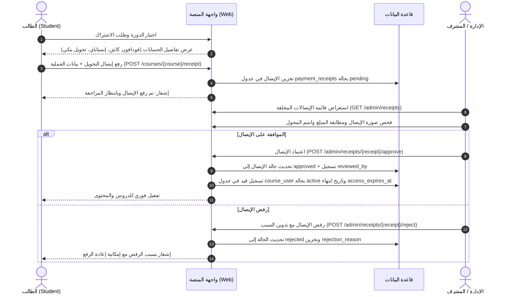
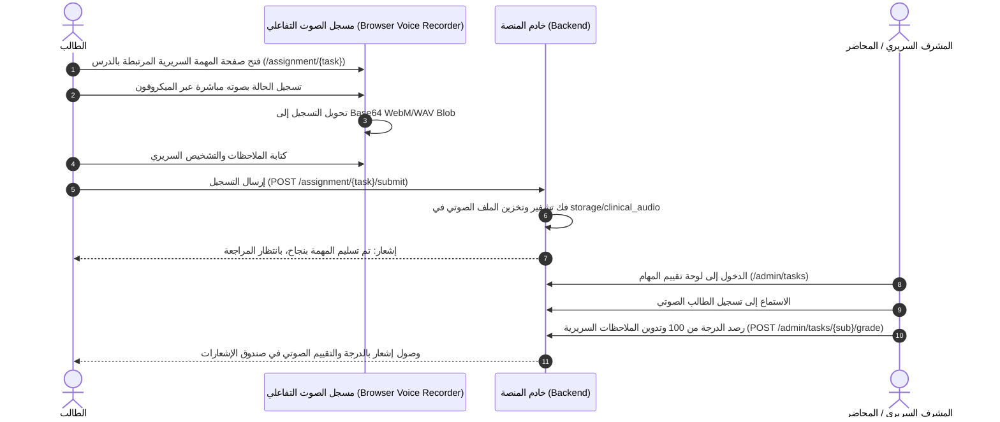
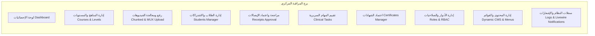

# دليل التدفق الشامل لمنصة الأمين التعليمية (Al-Ameen Educational Platform)
## Comprehensive End-to-End Platform Flow Architecture

---

## 1. نظرة عامة على المنصة (Platform Architecture Overview)

منصة **الأمين** (Al-Ameen) هي منصة تدريب وتعليم طبي وسريري متقدمة مصممة بنظام **Laravel 11+**، تجمع بين أحدث معايير الأمان، ومعالجة الفيديو المتطورة، وأنظمة التحقق والتقييم السريري الصوتي، ومنح الشهادات المعتمدة تلقائياً.

تعتمد المنصة على نمط حماية متعدد المستويات (Multi-Guard Architecture):
* **Guard `web`**: مخصص للطلاب، المتدربين، والزوار.
* **Guard `admin`**: مخصص لطاقم الإدارة، المشرفين السريريين، والمحاضرين مع نظام صلاحيات ديناميكي (Dynamic RBAC) ومفاتيح مرور بيومترية (Passkeys/WebAuthn).

```
+---------------------------------------------------------------------------------------------------+
|                                    AL-AMEEN MEDICAL PLATFORM                                      |
+---------------------------------------------------------------------------------------------------+
|                                                                                                   |
|  [ زوار وضيوف (Guests) ]    --> تصفح الكورسات | مشاهدة البرومو | التحقق من صحة الشهادات بالـ QR     |
|                                                                                                   |
|  [ الطلاب والمتدربون (Students) ] --> تسجيل ودخول (Email / Firebase Google) | رفع إيصالات الدفع     |
|                               --> مشاهدة الدروس (Mux Player + علامة مائية متحركة + قفل تسلسلي)     |
|                               --> تسليم المهام السريرية الصوتية (Voice Recorder / Audio Upload)    |
|                               --> إصدار الشهادات التلقائي فور تجاوز 95% إنجاز                      |
|                                                                                                   |
|  [ الإدارة والمشرفون (Admins) ] --> دخول فائق الأمان (Passkeys / WebAuthn / Firebase Google Auth) |
|                               --> إدارة المناهج والمستويات (Courses & Dynamic Levels)             |
|                               --> رفع الفيديوهات المجزأة (Resilient Chunked Upload & MUX Cloud)   |
|                               --> تقييم التسجيلات السريرية ورصد الدرجات والملاحظات                |
|                               --> مراجعة إيصالات الدفع والاعتماد التلقائي للاشتراكات              |
|                               --> إدارة الأدوار والصلاحيات (Dynamic RBAC Tower)                   |
+---------------------------------------------------------------------------------------------------+
```

---

## 2. أدوار المستخدمين ومستويات الوصول (User Roles & Permissions)

| نوع الحساب / الدور | البوابة / Guard | آليات تسجيل الدخول | الصلاحيات والمسؤوليات |
| :--- | :--- | :--- | :--- |
| **زائر / ضيف (Guest)** | لا يوجد (Public) | غير مسجل | تصفح الكتالوج، مراجعة تفاصيل الكورسات، مشاهدة الفيديو التعريفي (Promo)، التحقق من الشهادات عبر كود التحقق أو مسح رمز QR، قراءة التقييمات وصفحات التعريف. |
| **طالب / متدرب سريري (Student / User)** | `web` (`App\Models\User`) | كلمة مرور مشفرة + بريد مفعّل، أو حساب Google عبر Firebase، أو OTP عبر البريد الإلكتروني. | شراء الكورسات عبر رفع إيصالات الدفع، حضور الدروس والمحاضرات المقفلة تسلسلياً، تسجيل صوتي تفاعلي للمهام الإكلينيكية، استلام الشهادات التلقائية، تتبع نسب الإنجاز. |
| **المحاضر والمدرب السريري (Instructor)** | `admin` (`App\Models\Admin`) | بريد وكلمة مرور، Firebase Google، أو مفاتيح المرور البيومترية (Passkeys). | استعراض المحتوى والدروس، الاستماع لتسجيلات الطلاب الصوتية في المهام السريرية، رصد الدرجات (0-100) وكتابة التغذية الراجعة السريرية. |
| **المشرف السريري والأكاديمي (Clinical Supervisor)** | `admin` (`App\Models\Admin`) | بريد وكلمة مرور، Firebase Google، أو مفاتيح المرور البيومترية (Passkeys). | إدارة المناهج والكورسات والمستويات، رفع المحاضرات وتعديل إعدادات الفيديو، تقييم مهام الطلاب، اعتماد الشهادات يدوياً، مراجعة الطلاب المسجلين. |
| **المالك / مدير النظام (Super Admin / Owner)** | `admin` (`App\Models\Admin`) | بريد وكلمة مرور، Firebase Google، ومفاتيح Passkeys مع صلاحية `*` كاملة. | تحكم شامل في المنصة: إدارة المدراء والأدوار، مراجعة إيصالات الدفع واعتمادها، ضبط محتوى الموقع (CMS)، القوائم الديناميكية، إعدادات الفيديو وMUX، وسجلات النظام (Log Viewer). |

---

## 3. تدفق الزوار وغير المسجلين (Guest / Public Flow)

```mermaid
flowchart TD
    A[زيارة الصفحة الرئيسية Home /] --> B{اختيار المسار}
    B -->|تصفح الكتالوج| C[صفحة الكورسات /courses]
    B -->|التحقق من شهادة| D[التحقق بالـ QR /verify-certificate/{code}]
    B -->|التواصل والدعم| E[صفحة الاتصال /contact]
    B -->|تقرير المراجعة| F[صفحة تقرير التدقيق /audit-report]
    
    C --> G[صفحة تفاصيل الدورة /course-details?course=slug]
    G --> H[مشاهدة البرومو التعريفي Promo Video]
    G --> I[استعراض المنهج والمستويات Levels Hierarchy]
    G --> J[طلب التسجيل / الاشتراك]
    J --> K[التوجيه إلى تسجيل الدخول / إنشاء حساب]
```

### تفاصيل التدفق العام:
1. **الوصول للكتالوج العام**: يستعرض الزائر الكورسات المنشورة (`is_published = true`) مع الأسعار الأساسية والمخفضة، وعدد أيام الصلاحية (`access_duration_days`).
2. **مشاهدة الفيديو التعريفي (Promo Video)**: يتم تضمينه باستخدام مشغل الفيديو الآمن، سواء كان مستضافاً على **MUX** أو رابطاً مباشراً أو سيرفر المنصة.
3. **التحقق العام من الشهادات (`verify-certificate/{code}`)**: يمكن لأي جهة عمل أو مستشفى أو زائر فحص صحة شهادة الطالب بإدخال الكود الفريد (مثل `ALM-2026-X8B9K2L1`) أو مسح رمز الاستجابة السريع (SVG QR Code)، ليعرض النظام اسم الطالب، الدورة، تاريخ الإصدار، ونسبة الإنجاز المحققة.

---

## 4. تدفق المصادقة والحماية (Authentication & Security Flows)

### أ. تسجيل دخول الطلاب (Student Auth Flow - Guard `web`)
المنصة تدمج ثلاثة أنظمة مصادقة للطلاب:
1. **المصادقة التقليدية (Email & Hashed Password)**:
   * تتبع متطلبات Fortify مع التحقق الإجباري من البريد الإلكتروني (`MustVerifyEmail`).
   * تشفير كلمات المرور باستخدام أحدث خوارزميات التجزئة (`bcrypt` / `argon2id`).
2. **المصادقة السحابية Google Firebase (`FirebaseAuthController`)**:
   * يقوم المتصفح بمصادقة حساب Google عبر Firebase Client SDK واستخراج الـ ID Token.
   * يُرسل الـ Token عبر `POST /auth/google/firebase`.
   * يقوم خادم المنصة بالتحقق من صحة التوقيع عبر `FirebaseTokenVerifier`.
   * في حال كان المستخدم جديداً، يُنشأ حسابه تلقائياً مع تعيين `firebase_uid` و `google_id` وتفعيل بريده فوراً.
3. **استعادة كلمة المرور عبر الرمز السريع (6-Digit OTP Flow)**:
   * يطلب الطالب استعادة كلمة المرور عبر `POST /forgot-password`.
   * يُرسل النظام رمز تحقق مكوناً من 6 أرقام مؤمن ومؤقت (ينتهي خلال 10 دقائق مع حد أقصى للمحاولات لمنع هجمات التخمين Brute-Force).
   * يُدخل الطالب الرمز مع كلمة المرور الجديدة عبر `POST /reset-password`.

### ب. تسجيل دخول المدراء والمشرفين (Admin Auth Flow - Guard `admin`)
1. **بيئة معزولة بالكامل**: مسارات الإدارة تبدأ ببادئة `/admin` ومحمية بواسطة الـ Guard المستقل `admin` والجدول `admins`.
2. **مفاتيح المرور البيومترية (Passkeys / WebAuthn)**:
   * يدعم النظام تسجيل الدخول بدون كلمة مرور باستخدام بصمة الإصبع أو الوجه (FaceID / TouchID / Windows Hello / YubiKey).
   * التدفق:
     1. طلب التحدي: `GET /admin/passkeys/login/options` يُرجع التحدي العشوائي المشفر ومفاتيح الاعتماد المسموحة.
     2. توقيع المتصفح: يقوم الجهاز بتوقيع التحدي عبر المفتاح الخاص المخزن في شريحة الأمان (TPM/Secure Enclave).
     3. التحقق والحفظ: يُرسل التوقيع عبر `POST /admin/passkeys/login` ليتم مطابقة التوقيع بالمفتاح العام المخزن في جدول `admin_passkeys`.
3. **تسجيل دخول المدراء بـ Firebase Google**:
   * تدفق مخصص عبر `AdminFirebaseAuthController` مع مطابقة البريد الإلكتروني بقائمة المدراء المعتمدين حصراً.

---

## 5. تدفق الاشتراك والمدفوعات اليدوية (Enrollment & Payment Cycle)

نظراً لطبيعة التعاملات البنكية والمحافظ الإلكترونية في المنطقة، توفر المنصة نظام دورة دفع ومراجعة محكمة (Manual Payment Review & Auto-Granting):



### معايير إدارة فترة الوصول (Access Duration):
* يتم تفعيل اشتراك الطالب لمدة محددة مسبقاً لكل دورة (مثل 365 يوماً عبر حقل `courses.access_duration_days`).
* يتم احتساب تاريخ الانتهاء بدقة في حقل `course_user.access_expires_at`.
* في حال قام الطالب بتجديد الاشتراك قبل انتهائه، يقوم `CourseEnrollmentService` بتمديد الصلاحية انطلاقاً من تاريخ الانتهاء المستقبلي وليس من اليوم.
* يتم فحص صلاحية الوصول تلقائياً في كل مرة يحاول فيها الطالب فتح أي محاضرة أو رفع مهمة سريرية.

---

## 6. تدفق رحلة التعلم ومشاهدة المحاضرات (Student Learning Flow)

```mermaid
flowchart TD
    A[فتح صفحة الدرس /lesson/{course}/{video}] --> B{فحص صلاحية الطالب}
    B -->|الحساب موقوف Suspended| C[منع الوصول 403 Forbidden]
    B -->|لا يوجد اشتراك نشط| D[التحويل لصفحة الدورة لشراء الاشتراك]
    B -->|الدرس معاينة مجانية Free Preview| E[السماح بالمشاهدة المباشرة]
    B -->|اشتراك ساري المفعول| F{فحص القفل التسلسلي Sequential Lock}
    
    F -->|المحاضرة السابقة لم تكتمل| G[عرض شاشة القفل: يجب إكمال المحاضرة السابقة أولاً]
    F -->|المحاضرة السابقة مكتملة >= min_percentage| H[تجهيز مشغل الفيديو الآمن]
    
    H --> I[توليد رابط المشغل MUX / Bunny / HLS]
    H --> J[تفعيل العلامة المائية المتحركة Dynamic Watermark Canvas]
    H --> K[بدء المتابعة وإرسال نبضات التقدم POST /videos/{video}/progress]
    
    K --> L{هل وصلت النسبة >= min_completion_percentage?}
    L -->|نعم| M[فتح المحاضرة التالية تلقائياً]
    
    K --> N{هل وصل إجمالي تقدم الكورس >= 95%?}
    N -->|نعم| O[إصدار الشهادة المعتمدة فوراً وتوليد كود الـ QR]
```

### أركان تجربة المشاهدة الفائقة:
1. **نظام القفل التسلسلي (Sequential Video Locking)**:
   * مستوحى من المعايير الطبية لضمان استيعاب المادة العلمية بالترتيب.
   * لا يمكن للطالب تخطي درس إلى الذي يليه دون أن يشاهد ما لا يقل عن النسبة المحددة للدرس السابق (تحدد افتراضياً بـ 80% في حقل `videos.min_completion_percentage`).
2. **العلامة المائية المتحركة الديناميكية (Anti-Screen Recording Canvas Watermark)**:
   * طبقة Canvas برمجية شفافة ترتطم وتتحرك باستمرار فوق الفيديو بمسارات فيزيائية متغيرة.
   * تعرض بيانات الطالب الحقيقية: (الاسم الثلاثي، رقم الهاتف، المعرف الفريد للطالب ID، عنوان IP الحالي، والتاريخ والوقت).
   * تمنع وتثبط تماماً أي محاولة لتسجيل الشاشة أو تسريب المحتوى.
3. **نبضات حفظ التقدم (Real-time Progress Heartbeats)**:
   * يُرسل مشغل الفيديو نبضات دورية عبر AJAX إلى المسار `POST /videos/{video}/progress`.
   * يتم تخزين أعلى ثانية تمت مشاهدتها (`maxWatched`) لمنع التلاعب عبر تقديم شريط الفيديو بسرعة.
   * عند تحقيق النسبة المطلوبة، يُسجل الدرس كمكتمل (`is_completed = true`).

---

## 7. تدفق المهام السريرية والتقييم الصوتي (Clinical Tasks & Voice Grading)

تتميز المنصة بوجود نظام تدريب وتقييم سريري عملي يتيح للمحاضر اختبار النطق والمصطلحات والتشخيص الصوتي للطالب:



---

## 8. تدفق إصدار الشهادات والتحقق الذكي (Certification & QR Verification)

1. **الاستحقاق التلقائي**:
   * يتم تفعيل فحص الاستحقاق التلقائي لحظياً مع كل ثانية تقدم يسجلها الطالب في أي درس.
   * إذا تجاوز إجمالي متوسط تقدم الطالب في فيديوهات الدورة **95%** (أو النسبة المحددة في لوحة التحكم)، يتولى `CertificateService` إصدار الشهادة فوراً دون الحاجة لتدخل بشري.
2. **بنية الشهادة المعتمدة**:
   * **رمز الشهادة الفريد**: كود بتنسيق قياسي مشفر لا يتكرر: `ALM-YYYY-XXXXXXXX`.
   * **رمز QR ديناميكي متجهي (Vector SVG QR Code)**: يُنشأ برمجياً على السيرفر بدون أي مكتبات خارجية ثقيلة، ويقود مباشرة إلى رابط التحقق الرسمي.
3. **الاعتماد اليدوي الاستثنائي**:
   * يملك المشرف السريري صلاحية منح الشهادة يدوياً لأي متدرب (`POST /admin/students/{user}/certificates`) مع تحديد نسبة الإنجاز المعتمدة.
4. **صفحة التحقق العامة (`/verify-certificate/{code}`)**:
   * صفحة عامة سريعة التجاوب تتيح للمستشفيات والجهات الطبية التأكد من مصداقية الشهادة، تاريخ تخرج الطالب، واسم الدورة التدريبية.

---

## 9. تدفق برج المراقبة والإدارة (Admin Control Tower Architecture)

توفر لوحة التحكم المركزية للمشرفين والمدراء منظومة تشغيل شاملة:



### المهام التنفيذية في لوحة الإدارة:
* **إدارة المناهج الهرمية**: إنشاء دورات تدريبية، تقسيمها إلى مستويات (`levels`) متعددة، وترتيب المحاضرات وفق خطة التدريس.
* **إدارة الطلاب المعمقة (`StudentManagerController`)**:
  * استعراض بيانات الطالب ومتابعة سجل حضوره ونسب إنجازه لكل فيديو على حدة.
  * تعديل بيانات الطالب، إعادة تعيين كلمة المرور، أو إيقاف الحساب (`toggleStatus`) لمنع الوصول فوراً.
  * منح أو إلغاء الاشتراكات في الكورسات يدوياً مع تحديد فترات الصلاحية.
  * تعديل نسبة تقدم الطالب في أي محاضرة عند الحاجة التعليمية.
* **إدارة المحتوى المتقدمة (CMS & Settings)**:
  * تعديل نصوص الموقع وأقسامه بلغات متعددة (عربي / إنجليزي).
  * التحكم في عناصر القوائم العلوية والسفلية، تفعيلها أو إخفاؤها ديناميكياً.
  * التحكم في السياسات العامة مثل: قفل الفيديوهات التسلسلي، إظهار العلامة المائية، والنسبة الدنيا للشهادات.
* **بث الإشعارات التفاعلي**: نظام Livewire مخصص (`NotificationManager`) لإرسال تنبيهات لحظية للطلاب عند اعتماد الإيصالات أو تقييم المهام السريرية.

---

## 10. ملخص شامل لجدول المسارات والمكونات (Route & Component Matrix)

| المسار (Route) | الأسلوب (Method) | الغرض التعليمي والتقني | الصلاحية / Guard |
| :--- | :--- | :--- | :--- |
| `/` | `GET` | الصفحة الرئيسية واستعراض المنصة | عام (Public) |
| `/courses` | `GET` | كتالوج الكورسات المتاحة | عام (Public) |
| `/course-details` | `GET` | تفاصيل الدورة، المعاينة المجانية، والبرومو | عام (Public) |
| `/verify-certificate/{code}` | `GET` | التحقق من صحة ومصداقية الشهادة بالـ QR | عام (Public) |
| `/auth/google/firebase` | `POST` | تسجيل دخول الطلاب السحابي عبر Firebase Google | زائر (Guest) |
| `/forgot-password` & `/reset-password` | `GET/POST` | استعادة الحساب بواسطة رمز OTP مكون من 6 أرقام | زائر (Guest) |
| `/dashboard` | `GET` | لوحة تحكم الطالب ومتابعة الدورات المسجل بها | طالب مسجل (`auth:web`) |
| `/lesson/{course?}/{video?}` | `GET` | واجهة الدرس مع المشغل الآمن والعلامة المائية | طالب مسجل (`auth:web`) |
| `/videos/{video}/progress` | `POST` | تسجيل نبضات الحضور وثواني المشاهدة وتحديث القفل | طالب مسجل (`auth:web`) |
| `/courses/{course}/receipt` | `POST` | رفع إثبات وإيصال سداد الدورة | طالب مسجل (`auth:web`) |
| `/assignment/{task?}` | `GET/POST` | استعراض وتسليم المهمة السريرية الصوتية | طالب مسجل (`auth:web`) |
| `/certificates` | `GET` | استعراض وطباعة الشهادات المعتمدة المكتسبة | طالب مسجل (`auth:web`) |
| `/admin/login` | `GET/POST` | بوابة تسجيل دخول المدراء والمشرفين | زائر إدارة (`guest:admin`) |
| `/admin/passkeys/*` | `GET/POST` | المصادقة البيومترية للمدراء عبر WebAuthn | إدارة (`admin`) |
| `/admin/courses` | `Resource` | إدارة وتعديل الكورسات والمستويات التدريبية | إدارة (`admin`) |
| `/admin/courses/{c}/lessons/upload-chunk` | `POST` | رفع المحاضرات الضخمة بالتجزئة المقاومة لانقطاع السيرفر | إدارة (`admin`) |
| `/admin/receipts` & `.../approve` | `GET/POST` | مراجعة واعتماد إيصالات الدفع وتفعيل الاشتراكات تلقائياً | إدارة (`admin`) |
| `/admin/tasks` & `.../grade` | `GET/POST` | تقييم التسجيلات الصوتية ورصد درجات المتدربين السريرية | إدارة (`admin`) |
| `/admin/students` | `Resource` | برج التحكم في حسابات المتدربين واشتراكاتهم والشهادات | إدارة (`admin`) |
| `/webhooks/mux` | `POST` | استقبال إشعارات سحابة MUX المشفرة وتحديث الفيديوهات | سحابي موثق بـ HMAC-SHA256 |
