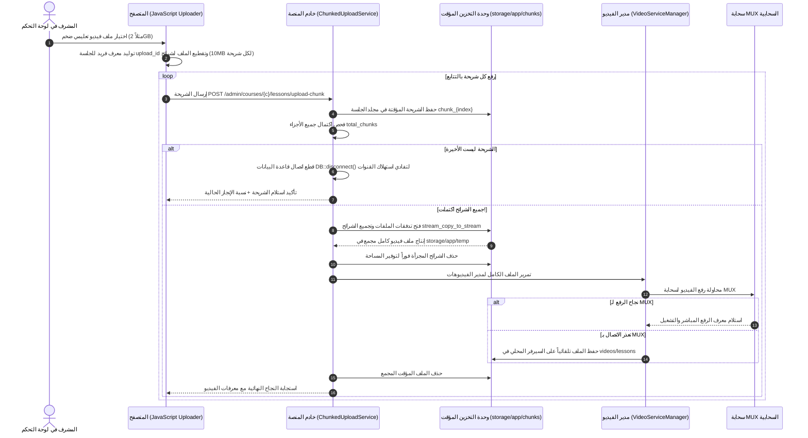
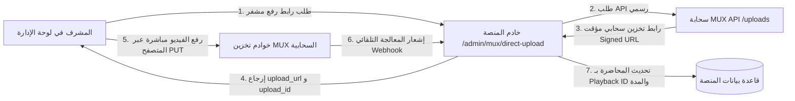
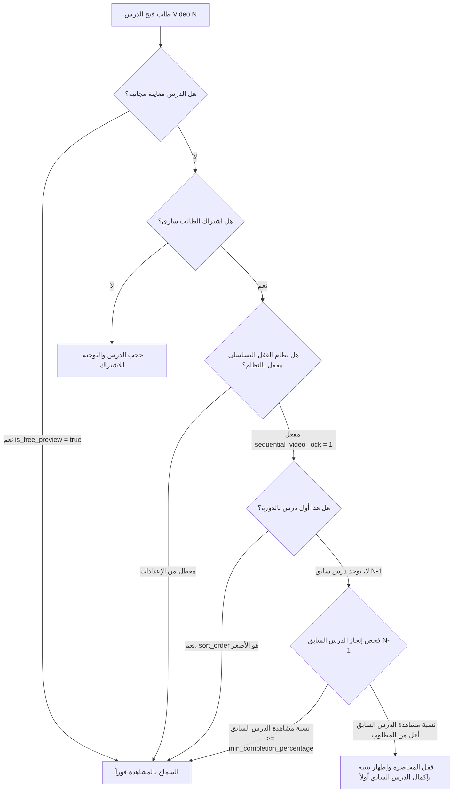

# الهندسة المعمارية الشاملة لمعالجة وبث وحماية الفيديوهات في منصة الأمين
## Complete Architecture of Video Ingestion, Processing, Streaming, and Anti-Piracy Security

---

## 1. فلسفة معالجة الفيديو في المنصة (Architectural Philosophy)

في منصة **الأمين التعليمية**، يمثل الفيديو العمود الفقري للمحتوى التعليمي والسريري. لضمان أقصى درجات الاستقرار، وتوفير تجربة مشاهدة سلسة للطلاب في مختلف ظروف الاتصال، وحماية المحتوى الطبي الحصري من التسريب والقرصنة، صُممت المنظومة بناءً على أربعة أركان أساسية:

1. **المرونة والمقاومة للأعطال (High Resilience & Failover)**: نظام مبني بنمط المحركات المتعددة (Multi-Driver Manager Pattern). في حال تعطل أو عدم تهيئة السحابة الرئيسية (مثل MUX)، يتحول النظام تلقائياً وبشكل غير محسوس إلى السيرفر المحلي.
2. **رفع الملفات الضخمة بالتجزئة (Chunked Resilient Upload)**: تجاوز قيود خوادم الاستضافة المشتركة (Shared Hosting Limits) وأوقات انتهاء الاتصال (PHP Timeouts) عبر تقطيع الفيديو إلى أجزاء صغيرة (Chunks) ورفعها بالتتابع.
3. **الحماية القصوى من القرصنة وتسجيل الشاشة (Active Anti-Piracy Defense)**: تقنية العلامة المائية الديناميكية العائمة (Dynamic Canvas Watermark) التي تدمج بيانات المتدرب الحية فوق شاشة العرض.
4. **التحكم الأكاديمي الصارم (Sequential Video Locking & Progress Heartbeats)**: اشتراط إنهاء نسبة محددة من كل محاضرة قبل فك القفل عن المحاضرة التالية، ومراقبة ثواني المشاهدة الفعلية بدقة.

```
+---------------------------------------------------------------------------------------------------+
|                                 VIDEO PROCESSING & STREAMING PIPELINE                             |
+---------------------------------------------------------------------------------------------------+
|                                                                                                   |
|  [ مصادر الإدخال والرفع ]                                                                         |
|    ├── 1. رفع مجزأ عبر السيرفر (Chunked 10MB Slices) ──> تجميع آمن ──> تحويل لـ MUX / Local       |
|    ├── 2. رفع مباشر من المتصفح لسحابة MUX (Direct Upload URL) ──> معالجة سحابية بدون استهلاك السيرفر|
|    ├── 3. رفع ملف مباشر مع حماية السقوط التلقائي (Auto-Fallback)                                   |
|    └── 4. إدخال روابط خارجية (MUX ID, YouTube, Vimeo, Bunny.net, HLS .m3u8, Local Storage)        |
|                                                                                                   |
|  [ طبقة التخزين والتوزيع ]                                                                         |
|    ├── MUX Cloud Infrastructure (HLS Adaptive Bitrate Streaming)                                  |
|    ├── Bunny.net Stream (Tokenized Signed URLs & CDN Embeds)                                      |
|    └── Local Protected Storage (/storage/videos/lessons/ مع فحص أمني لمنع التحميل المباشر)       |
|                                                                                                   |
|  [ مشغل الفيديو وتجربة المتدرب ]                                                                  |
|    ├── مشغل متطور <mux-player> يدعم البث التكيفي حسب سرعة الإنترنت                                |
|    ├── علامة مائية متحركة ترتطم بالحواف (Canvas Overlay: الاسم + الهاتف + المعرف + IP + الوقت)     |
|    ├── قفل تسلسلي ذكي يمنع فتح الدرس التالي إلا بعد استيفاء نسبة الإنجاز المطلوبة                |
|    └── نبضات حفظ التقدم اللحظية (Heartbeat API) والتأهل للشهادة عند 95%                          |
+---------------------------------------------------------------------------------------------------+
```

---

## 2. بنية محركات الفيديو المتعددة (Multi-Driver Video Architecture)

تعتمد المنصة على فئة إدارة موحدة هي `App\Services\Video\VideoServiceManager` ترث من كلاس `Illuminate\Support\Manager` في Laravel، وتدير المحركات المتوافقة مع واجهة `App\Services\Video\Contracts\VideoDriverInterface`:

### أ. واجهة المحرك البرمجية (`VideoDriverInterface`)
تفرض الواجهة توحيد العمليات الأساسية عبر جميع المحركات:
```php
interface VideoDriverInterface
{
    public function name(): string;
    public function title(): string;
    public function isConfigured(): bool;
    public function handleUpload(UploadedFile $file): array;
    public function createDirectUploadUrl(string $corsOrigin = '*'): ?array;
    public function parseInput(string $input): array;
}
```

### ب. المحركات المدعومة رسمياً في المنظومة:
1. **محرك سحابة MUX (`App\Services\Video\Drivers\MuxDriver`)**:
   * المحرك السحابي الافتراضي لبث الفيديو بتقنية التقطيع التكيفي (HLS Adaptive Bitrate).
   * يتيح الرفع المباشر من المتصفح عبر Signed Upload URLs.
2. **محرك التخزين المحلي للمنصة (`App\Services\Video\Drivers\LocalDriver`)**:
   * يعمل كشبكة أمان دائمة ومضمونة (Always Available Fallback).
   * يخزن ملفات الفيديو داخل `storage/app/public/videos/lessons`.
   * يقوم بتسمية الملفات بتنسيق فريد يمنع تداخل الأسماء: `lesson_YYYYmmdd_His_Random10.mp4`.
3. **محرك شبكة Bunny.net (`App\Services\Video\BunnyStreamService`)**:
   * يدعم التضمين الآمن عبر Iframe المشفر بالرموز المميزة (SHA256 Security Token Key).
   * يدعم روابط قوائم تشغيل HLS الموقعة رقمياً مع تحديد وقت صلاحية بالثواني لمنع مشاركة الروابط.
4. **محلل الروابط الخارجية (External Input Parsers)**:
   * يقوم المحرك بتحليل نصوص الروابط وتحديد نوع المصدر تلقائياً عبر تعبيرات نمطية (Regular Expressions):
     * معرف MUX المباشر (مثل `DS00Spx1CV902MCtP7ToneAwBpR00uoJq`).
     * روابط بث MUX الرسمية (`https://stream.mux.com/{PLAYBACK_ID}.m3u8`).
     * فيديوهات YouTube (سواء روابط `watch?v=` أو روابط المشاركة `youtu.be`).
     * فيديوهات Vimeo (`vimeo.com/{ID}`).
     * روابط بث HLS المباشرة التي تنتهي بـ `.m3u8`.
     * روابط التخزين المحلي للمنصة (`/storage/...`).

---

## 3. مسارات رفع وتجهيز الفيديوهات (Video Ingestion Pipelines)

توفر المنصة ثلاثة مسارات متقدمة لرفع ومعالجة الفيديوهات تضمن راحة المشرف وعدم انقطاع الرفع:

### المسار الأول: الرفع المجزأ المقاوم للانقطاع (Chunked Resilient Upload Pipeline)
صُمم هذا المسار خصيصاً للتغلب على التحديات الشائعة في الخوادم والاستضافات المشتركة، مثل محدودية أحجام الرفع (`upload_max_filesize` و `post_max_size`)، وانقطاع الاتصال عند رفع ملفات تدريبية تتجاوز 1 إلى 4 جيجابايت.



#### مميزات المعالجة في `ChunkedUploadService`:
* **تطهير معرف الجلسة (`sanitizeUploadId`)**: تنظيف المعرف لمنع أي هجمات حقن لمسارات المجلدات (Directory Traversal).
* **إدارة استهلاك الذاكرة**: ضبط مخصص `ini_set('memory_limit', '1024M')` وتصفير وقت انتهاء التنفيذ `set_time_limit(0)`.
* **منع استنزاف اتصالات قواعد البيانات**: استدعاء `DB::disconnect()` خلال معالجة الشرائح الفردية على بيئات الإنتاج لضمان بقاء السيرفر قادراً على خدمة طلبات الطلاب دون تأثر بعمليات الرفع الثقيلة.

---

### المسار الثاني: الرفع المباشر من المتصفح إلى السحابة (MUX Direct Upload Flow)
يتيح هذا المسار رفع الفيديو مباشرة من حاسوب المشرف إلى سحابة **MUX** دون المرور عبر خادم المنصة إطلاقاً، مما يوفر استهلاك الباندويث ومعالج السيرفر بنسبة 100%.



---

### المسار الثالث: الرفع القياسي مع السقوط التلقائي الآمن (Resilient File Upload)
في حال استخدام نموذج الرفع المباشر في صفحة إنشاء الكورس أو الدرس (`StoreVideoRequest` / `CourseController`):
1. يستقبل `VideoServiceManager` الملف بصيغة `UploadedFile`.
2. يحاول رفعه إلى المحرك الافتراضي المضبوط في الإعدادات (`config('video.default')` وهو `mux`).
3. إذا كان المحرك غير مهيأ، أو حدث أي خطأ شبكي أثناء الرفع إلى سحابة MUX، يتم تسجيل تحذير في سجلات النظام (`Log::warning`).
4. ينتقل النظام فوراً إلى المحرك المحلي `LocalDriver` ليتم تخزين الفيديو داخل `storage/app/public/videos/lessons` دون أن يشعر المشرف بأي انقطاع أو ظهور أخطاء بالنظام.

---

## 4. حماية الفيديوهات من التحميل المباشر والقرصنة (Video Protection & Access Control)

لحماية المحاضرات الطبية من التسريب، تطبق المنصة استراتيجية دفاعية متعددة الطبقات:

### أ. حماية مسار التخزين البديل (`/storage/videos/lessons/...`)
عادة ما تسمح خوادم الويب بتحميل الملفات الموجودة في مجلد `public` مباشرة بدون فحص الصلاحيات. في منصة الأمين، تم بناء مسار خاص محكم داخل `routes/web.php` لمعالجة هذا الخطر:

```php
Route::get('storage/{path}', function (string $path) {
    // 1. منع هجمات تخطي المسارات (Directory Traversal Prevention)
    $fullPath = storage_path('app/public/'.$path);
    $realStoragePath = realpath(storage_path('app/public'));
    $realFullPath = realpath($fullPath);

    if (! $realFullPath || ! $realStoragePath || ! str_starts_with($realFullPath, $realStoragePath) || ! file_exists($realFullPath)) {
        abort(404);
    }

    // 2. التحقق من صلاحية الوصول لفيديوهات الدروس المحمية
    if (str_starts_with($path, 'videos/lessons/')) {
        $user = auth()->user();
        $admin = auth('admin')->user();

        // يسمح للمدير مباشرة، أما الطالب فيخضع للفحص الدقيق
        if (! $admin) {
            if (! $user instanceof User) {
                abort(403, __('تسجيل الدخول مطلوب للوصول إلى هذا المحتوى.'));
            }

            $video = Video::query()->where('video_url', 'like', '%'.$path.'%')->first();
            if ($video && ! app(VideoProgressService::class)->canAccessVideo($user, $video)) {
                abort(403, __('غير مصرح لك بالوصول إلى هذا الفيديو.'));
            }
        }
    }

    return response()->file($realFullPath);
})->where('path', '.*')->name('storage.fallback');
```

---

### ب. العلامة المائية المتحركة الديناميكية (Dynamic Anti-Recording Watermark)
مكونة كعنصر Blade تفاعلي في `resources/views/components/video-watermark-player.blade.php`:

```
+-----------------------------------------------------------------------------+
|  [ مشغل الفيديو التعليمي / Mux Player / Video Container ]                   |
|                                                                             |
|                               +-------------------------------+             |
|                               | د. أحمد محمد السيد             |             |
|                               | 01012345678 - ID: STD-4092    | <--- ترتطم   |
|                               | IP: 197.160.42.11             |      وتتحرك  |
|                               +-------------------------------+      باستمرار|
|                                       \                                     |
|                                        \  متجه الحركة (Velocity vx, vy)      |
|                                         v                                   |
|                                                                             |
+-----------------------------------------------------------------------------+
```

#### الخصائص التقنية للعلامة المائية:
1. **عدم إمكانية الإزالة عبر أدوات التفتيش (Canvas Native Rendering)**: لا تعتمد على عناصر HTML نصية يمكن إخفاؤها بـ CSS أو أدوات المطورين، بل تُطبع وتُرسم مباشرة عبر محرك رسوميات Canvas (`2d context`).
2. **شبه شفافة ولا تعيق الرؤية التعليمية**: شفافية مدروسة (`globalAlpha = 0.45` و `class="opacity-75"`) مع طبقة حماية للمؤشر (`pointer-events-none`) تسمح بالتحكم بمشغل الفيديو الموجود تحتها بكل سلاسة.
3. **حركة فيزيائية ترتد عن الحواف (Bouncing Physics Animation)**:
   * تعتمد على خوارزمية ارتداد فيزيائية (`requestAnimationFrame`):
     ```javascript
     if (this.posX + textWidth >= this.canvas.width || this.posX <= 0) {
         this.vx = -this.vx;
     }
     if (this.posY + textHeight >= this.canvas.height || this.posY <= 0) {
         this.vy = -this.vy;
     }
     ```
4. **شخصنة الفيديو (Identity Embedding)**: في حال تم تصوير الشاشة بكاميرا خارجية أو هاتف محمول، تظهر هوية الطالب بوضوح، مما يمنع تسريب المادة التعليمية نهائياً.

---

## 5. نظام القفل التسلسلي وحساب نسب الإنجاز (Sequential Locking & Progress Engine)

تخضع جميع المحاضرات لمعايير صارمة عبر `App\Services\Video\VideoProgressService`:

### أ. خوارزمية فحص إمكانية فتح الدرس (`canAccessVideo`):


### ب. خوارزمية تسجيل النبضات ومنع التلاعب بالوقت:
عند استدعاء المسار `POST /videos/{video}/progress`:
1. يتم فحص الصلاحية بواسطة `canAccessVideo`. في حال المخالفة يُلقى استثناء `AccessDeniedHttpException`.
2. يتم جلب أو إنشاء سجل في جدول `video_progress` للمستخدم والفيديو المحدد.
3. **منع الغش والتلاعب**: يتم أخذ القيمة الأعلى دائماً بين الثواني المخزنة سابقاً والثواني المستلمة:
   ```php
   $maxWatched = max($progress->watched_seconds ?? 0, $currentWatchedSeconds);
   $percentage = min(100.0, round(($maxWatched / $duration) * 100, 2));
   $isCompleted = ($percentage >= $video->min_completion_percentage) || ($progress->is_completed ?? false);
   ```
4. **إعادة احتساب إجمالي تقدم الدورة الكلي**:
   يتم حساب متوسط نسب المشاهدة عبر جميع فيديوهات الكورس:
   $$\text{Course Progress \%} = \frac{\sum_{i=1}^{M} \min(100, \text{Video Progress \%}_i)}{M}$$
   حيث $M$ هو إجمالي عدد فيديوهات الدورة.
5. **الزناد التلقائي للشهادات (Auto-Certificate Trigger)**:
   إذا بلغت النسبة المحسوبة **95%** أو أكثر، يُصدر النظام الشهادة مباشرة مع كود QR دون انتظار أي مراجعة يدوية.

---

## 6. مصفوفة مقارنة مصادر الفيديو في المنصة (Video Sources Matrix)

| خاصية المقارنة | سحابة MUX Cloud | السيرفر المحلي Local Server | شبكة Bunny.net | روابط التضمين الخارجية (YouTube/Vimeo) |
| :--- | :--- | :--- | :--- | :--- |
| **تقنية البث** | HLS Adaptive Bitrate (`.m3u8`) | تنزيل متدفق مستمر (HTTP Range / MP4) | HLS + Iframe Embed | مشغلات خارجية عبر Iframe |
| **التوافق مع سرعة الإنترنت** | فائق (تغيير الجودة تلقائياً من 1080p إلى 360p حسب سرعة المتدرب) | ثابت (يعتمد على حجم ملف الـ MP4 وسرعة استضافة المنصة) | ممتاز جداً عبر شبكة CDN عالمية | ممتاز ولكن مشتت وغير معزول |
| **طريقة الرفع** | تجزئة 10MB مجمعة أو رفع مباشر من المتصفح عبر Signed URL | رفع مجزأ 10MB يجمع ويحفظ في مجلد `videos/lessons` | رفع عبر واجهة برمجة تطبيقات Bunny أو لوحة التحكم | لصق الرابط فقط |
| **العلامة المائية المتحركة** | مدعومة بالكامل فوق مشغل `<mux-player>` | مدعومة بالكامل فوق وسم `<video>` | مدعومة بالكامل فوق الـ Iframe | مدعومة بالكامل فوق الـ Iframe |
| **درجة الأمان** | عالية جداً (HLS مجزأ يصعب تحميله بالبرامج التقليدية) | محمية بـ Middleware وفحص اشتراك في مسار `/storage` | عالية عبر Signed Tokens و Pull Zone Restrictions | منخفضة (يمكن نسخ الرابط أو فتحه خارج المنصة) |
| **استهلاك موارد السيرفر** | صفر (المعالجة والتخزين والبث على سحابة MUX) | يستهلك مساحة القرص وباندويث خادم المنصة | استهلاك منخفض جداً عبر شبكة CDN مستقلة | صفر |
